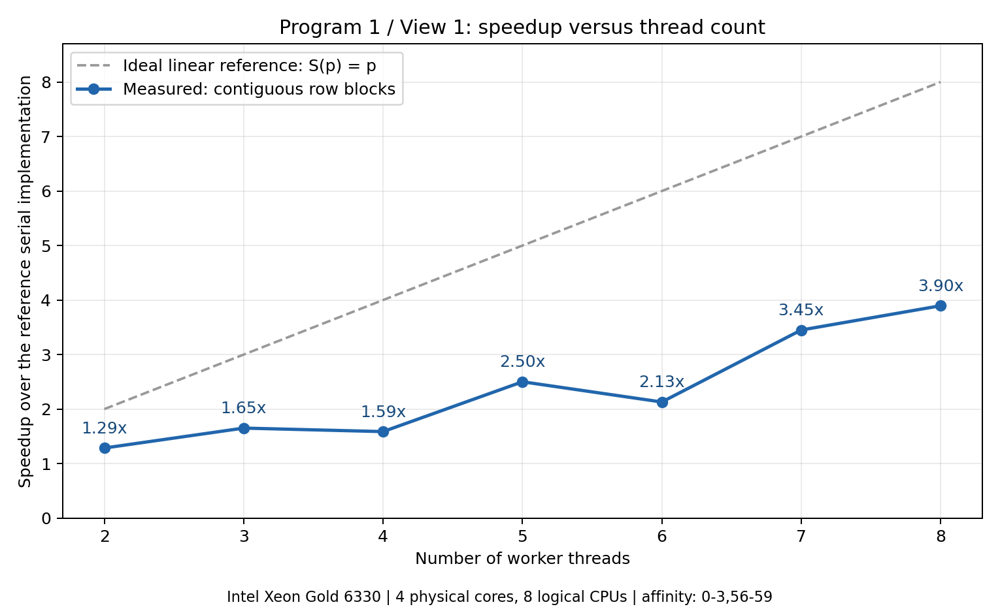
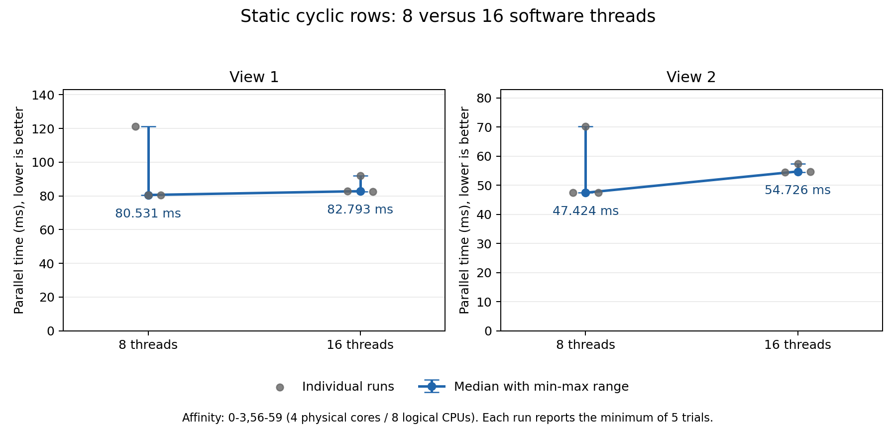

# Prog1：使用线程并行生成 Mandelbrot 图像

本报告基于本地自学实验，不使用 Stanford myth 机器。原始日志与图像位于 [logs/](logs/)，完整环境与实验过程见 [LOCAL_EXPERIMENTS.md](../LOCAL_EXPERIMENTS.md)。

## 实验条件与测量方法

- 服务器 CPU 为 Intel Xeon Gold 6330，整机有两个插槽、56 个物理核心、112 个逻辑 CPU。
- 本实验始终通过 `taskset -c 0-3,56-59` 限制在同一组四个物理核心、八个逻辑 CPU 上。逻辑 CPU 配对为 `0/56`、`1/57`、`2/58`、`3/59`。
- 使用 Linux x86-64、g++ 13.3.0 和 GNU Make 4.3；沿用 Makefile 的 `-m64 -O3 -std=c++11` 等编译参数。
- 图像大小为 1600×1200，最大迭代次数为 256。两个视图分别测量，均以课程提供的串行实现为基准。
- 每次启动程序，串行与并行实现分别运行五次，各取最短时间。单次加速比为 `S(p) = Tserial / Tparallel(p)`，使用同一次程序运行中的两个耗时。
- 最终八线程和十六线程的每种视图配置各启动程序三次，保留全部原始数据，分别报告并行耗时与单次加速比的中位数。
- 所列各次程序运行均通过内置串行与并行输出一致性校验。最终测量已移除逐线程诊断计时与打印。
- 服务器采用动态频率，实验没有独占 CPU。原始记录存在明显波动，报告保留这些现象。

## 1. 两线程空间分解

首先使用连续行分块，将图像上半部分交给线程 0，下半部分交给线程 1。线程 0 由主线程直接执行，另创建一个 `std::thread` 执行线程 1，计算结束后通过 `join()` 等待完成。

推广到 `p` 个线程时，线程 `t` 的行范围为：

```text
startRow = height * t / p
endRow   = height * (t + 1) / p
```

处理区间是 `[startRow, endRow)`。在本实验的两线程配置下，两个线程分别计算第 0–599 行与第 600–1199 行。相邻分块的边界一致，即使图像高度不能整除线程数，也不会遗漏行。

两个视图的两线程结果均通过串并行输出一致性检查。

## 2. 连续分块的加速比曲线

原始数据见 [block-view1.log](logs/block-view1.log)。该轮 View 1 加速比如下：

| 线程数 | 2 | 3 | 4 | 5 | 6 | 7 | 8 |
| --- | --- | --- | --- | --- | --- | --- | --- |
| 加速比 | 1.29× | 1.65× | 1.59× | 2.50× | 2.13× | 3.45× | 3.90× |



加速比没有随线程数线性增长，原始曲线还在四线程与六线程处出现回退。平均分配行数只能使各线程获得相近数量的像素，但像素需要的迭代次数不同。因此，连续分块可能造成计算负载不均，整体运行时间受最慢线程限制。

三线程尤其容易暴露这个问题：三个线程各处理 400 行，中间那块可能包含更多需要较多迭代的像素。四个物理核心上的八个逻辑 CPU 也共享部分硬件资源，不能预设线程数翻倍就一定使速度翻倍。

后续完整逐线程测量中，四线程和六线程的回退没有稳定重现。因此，负载不均可以解释并行效率受限，但当前证据不足以将原曲线的每一个回退都归因于分块策略。

## 3. 使用逐线程计时检验假设

在 `workerThreadStart()` 入口记录开始时刻，完成计算后记录结束时刻，将两者之差保存到该线程自己的参数记录。所有工作线程完成后，由主线程统一打印耗时。

[三线程诊断日志](logs/block-view1-t3-timing.log)的第 4 轮结果为：

| 线程 | 行范围 | 耗时 / ms |
| --- | --- | --- |
| 0 | 0–399 | 177.918 |
| 1 | 400–799 | 355.478 |
| 2 | 800–1199 | 124.363 |

五轮中线程 1 始终最慢，符合中间区域所在的线程成为瓶颈的判断。线程 0 和线程 2 完成后不能处理线程 1 剩余的任务，程序必须等待它完成。整体并行耗时大致由最慢线程的耗时及线程管理开销决定。

[2–8 线程的完整诊断日志](logs/block-view1-thread-timing.log)也体现了中间区域与边缘区域的耗时差异。例如八线程第 5 轮，线程 0 与线程 7 分别只需 11.138 ms、11.276 ms，而线程 3 与线程 4 分别需要 143.203 ms、144.147 ms。

这些结果支持连续分块存在负载不均的解释。不过，测量的是实际经过时间，也包含调度与资源竞争的影响，不能仅凭耗时精确区分纯计算量与系统因素。

## 4. 改进为静态交错行分配

最终实现让线程 `t` 处理以下各行，其中 `p` 是线程总数：

```text
t, t+p, t+2p, ...，直到行号达到图像高度
```

对应代码为：

```cpp
for (unsigned int row = args->threadId;
     row < args->height;
     row += args->numThreads) {
    mandelbrotSerial(
        args->x0, args->y0, args->x1, args->y1,
        args->width, args->height,
        row, 1,
        args->maxIterations,
        args->output);
}
```

每次调用计算一行，同时保留整张图像的宽高，以正确计算像素在复平面中的坐标。交错分配使每个线程都能处理图像上、中、下部的行，有助于分散高迭代区域的工作。

每行 `r` 唯一归属于线程 `r % p`，因此所有行恰好处理一次，不同线程写入不同的行。工作线程之间不需要增加锁、共享任务计数器或通信；使用起始代码中的 `join()` 等待完成。同一个分配公式适用于不同线程数与两个视图，没有为单独配置硬编码。

最终八线程结果为：

| 视图 | 三次单次加速比 | 加速比中位数 | 并行耗时中位数 / ms |
| --- | --- | --- | --- |
| View 1 | 4.83×、7.28×、7.29× | 7.28× | 80.531 |
| View 2 | 7.04×、4.79×、7.08× | 7.04× | 47.424 |

两个视图的加速比中位数均达到题目约 7–8× 的参考目标。每组均出现一次约 4.8× 的慢样本，全部数据均已保留。连续分块与最终交错分配的数据来自不同批次，不将所有耗时变化都归因于算法改进。

## 5. 十六线程与八线程比较



图中保留三次独立运行的原始点，并标出中位数和最小值至最大值的范围。每个原始点仍是一次程序内部五次并行测量的最短时间。

| 视图 | 八线程耗时中位数 / ms | 十六线程耗时中位数 / ms | 耗时变化 |
| --- | --- | --- | --- |
| View 1 | 80.531 | 82.793 | 增加约 2.8% |
| View 2 | 47.424 | 54.726 | 增加约 15.4% |

本次实验没有观察到十六线程进一步提速。两种线程配置都限制在同样的四个物理核心、八个逻辑 CPU 上，更多软件线程没有增加可用的硬件执行位置。额外的线程创建、调度和资源竞争等成本可能抵消任务进一步细分的收益。本实验没有单独量化这些成本，且样本较少，不据此声称 View 1 约 2.8% 的差异具有统计显著性。

View 1 的某次十六线程日志显示 10.99×，但对应串行基准为 909.805 ms，明显慢于另两次约 587 ms 的基准。该次并行耗时为 82.793 ms，并未快于八线程的两次约 80 ms 结果。因此，判断增加线程是否有收益时，应比较并行耗时，并同时检查串行基准是否发生变化。

