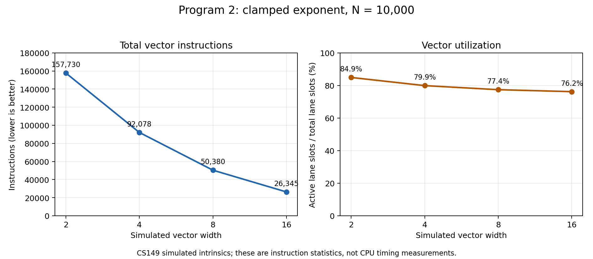

# Prog2：使用模拟 SIMD 指令计算截断幂与数组求和

本报告记录必做截断幂与选做数组求和。使用课程提供的 CS149 模拟向量指令，性能指标为模拟指令数量与向量通道利用率。硬件、软件及本地实验条件见 [LOCAL_EXPERIMENTS.md](../LOCAL_EXPERIMENTS.md)。


## 向量宽度实验

固定 `N=10000` 和计算实现，只改变 `CS149intrin.h` 中的 `VECTOR_WIDTH`，每次修改后通过 `make` 重新编译，再执行 `./myexp -s 10000`。四种宽度的必做结果校验均通过。

| 向量宽度 | 总向量指令数 | 向量利用率 | 活动通道位置数 | 总通道位置数 | 原始日志 |
| --- | --- | --- | --- | --- | --- |
| 2 | 157730 | 84.9% | 267972 | 315460 | [width2-n10000.log](logs/width2-n10000.log) |
| 4 | 92078 | 79.9% | 294404 | 368312 | [width4-n10000.log](logs/width4-n10000.log) |
| 8 | 50380 | 77.4% | 311780 | 403040 | [width8-n10000.log](logs/width8-n10000.log) |
| 16 | 26345 | 76.2% | 321044 | 421520 | [width16-n10000.log](logs/width16-n10000.log) |



## 为什么利用率下降

每个元素的指数不同，因此需要执行的乘法次数不同。向量循环必须持续到本组最后一个通道完成；提前完成的通道在后续乘法与计数递减指令中被掩码关闭。组越宽，组内出现较大指数的机会越高，更多较早完成的通道需要等待，导致这些操作的活动通道比例降低。

例如指数 `[1,1,1,9]` 对应剩余乘法次数 `[0,0,0,8]`，后续八轮乘法均只有最后一个通道活动。更窄的向量可以将不同元素分成更多独立的组，各组分别结束自己的循环。

这个现象也可以从当前实现的指令数推算。令组数为 `B=N/VECTOR_WIDTH`，第 `g` 组执行 `M_g` 次乘法循环。当前函数有 6 条一次性初始化指令、每组 11 条固定指令，以及每轮循环 4 条指令，因此：

```text
I = 6 + 11*B + 4*sum(M_g)
```

四条循环指令分别为乘法、计数递减、活动条件比较，以及下次循环条件中的 `cntbits`。按日志中的指令总数推算，宽度 2、4、8、16 每组平均循环次数分别为约 5.14、6.46、7.32、7.79，体现较宽分组更容易由较长的循环决定完成时间。

`10000` 能被四种宽度整除，因此本次利用率下降不来自尾部不足一个向量宽度。模拟器的整体利用率为累计活动通道位置除以累计总通道位置；它也统计比较、`cntbits` 等操作，不能直接等同于乘法指令的利用率。

## 为什么指令数仍然减少

宽度增加后，同一条指令可以处理更多元素，组数由 5000 减少到 625。虽然每组平均循环次数增加、部分通道需要等待，整体模拟指令数仍由 157730 降至 26345。

## 选做：向量求和与归约

`arraySumVector()` 使用题目允许的前提：`N` 为向量宽度的整数倍，向量宽度为 2 的幂。

第一阶段按向量宽度遍历输入，每次加载一组并累加到同一个向量的对应通道。例如宽度为 4、输入为 1–8 时，累加向量最终为 `[6,8,10,12]`。

第二阶段重复执行相邻求和 `hadd` 和偶奇重排 `interleave`。`hadd` 将每对相邻通道的和分别写入两个位置，`interleave` 把偶数下标移到前半部分，使不同的部分和在下一轮相邻。示例依次得到 `[14,14,22,22]`、`[14,22,14,22]`、`[36,36,36,36]`，最后返回第 0 个通道的值。

`hadd` 使用临时输出向量，再以该临时向量为输入执行 `interleave`，避免重排时覆盖仍需读取的输入。每轮后独立部分和数量减半，执行 `log2(VECTOR_WIDTH)` 轮即可完成归约。

按题目将向量操作视为常数步的模型，两阶段分别需要 `O(N/VECTOR_WIDTH)` 和 `O(log2(VECTOR_WIDTH))` 个步骤，合计为：

```text
O(N/VECTOR_WIDTH + log2(VECTOR_WIDTH))
```

在临时副本中，对宽度 1、2、4、8、16 各执行 18 个精确求和案例，共 90 个案例，ASan/UBSan 均通过，见 [array-sum-proposed-check.log](logs/array-sum-proposed-check.log)。用户随后已将该实现写入作业文件；宽度 16、`N=10000` 的实际程序运行中，必做截断幂与选做数组求和均显示 `Passed!!!`，见 [array-sum-n10000.log](logs/array-sum-n10000.log)。

浮点求和改变了加法分组，结果可能与串行累加有舍入差异，实际程序按约 0.2 的绝对误差阈值校验。主程序在调用选做求和前已打印向量统计，因此上述宽度实验的统计只涵盖必做部分。另外，辅助函数 `hadd` 与 `interleave` 当前没有调用日志记录器，归约复杂度依据算法结构分析。
