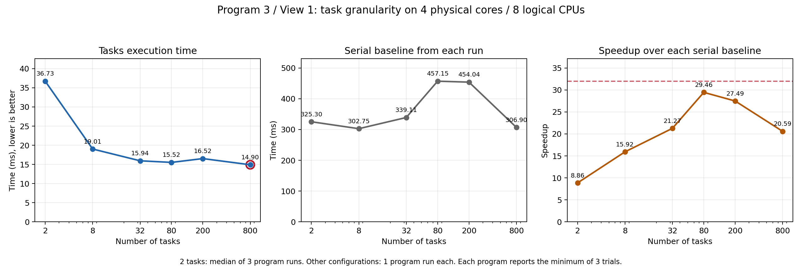

# Prog3：使用 ISPC 生成 Mandelbrot 图像

本报告记录本地实验结果，不使用 Stanford myth 机器。完整硬件与工具版本见 [LOCAL_EXPERIMENTS.md](../LOCAL_EXPERIMENTS.md)。

## 第一部分：单线程 SIMD

### 实验条件

- 本机 CPU 为 Intel Xeon Gold 6330；本部分按指导命令通过 `taskset -c 0` 固定到逻辑 CPU 0。
- 图像大小为 1200×800，最大迭代次数为 256，两个视图分别测量。
- 使用 ISPC 1.28.1，保留 Makefile 的 `--target=avx2-i32x8` 八通道目标；C++ 使用 `-O3 -ffp-contract=off`，ISPC 使用 `-O3 --opt=disable-fma` 等原有参数。
- 程序不带 `--tasks`。普通 ISPC 函数通过单个调用线程执行 SIMD 代码，不会因为八通道而创建八个操作系统线程。
- 每个视图启动程序一次；串行与 ISPC 实现各运行三次，报告各自最短时间，加速比使用同次程序运行中的串行耗时除以 ISPC 耗时。
- 服务器采用动态频率，CPU 没有独占。当前两份日志不能反映同一视图重复启动程序的波动范围。

### 结果

| 视图 | 串行耗时 / ms | ISPC 耗时 / ms | 加速比 | 原始日志 |
| --- | --- | --- | --- | --- |
| View 1 | 312.327 | 62.185 | 5.02× | [view1/ispc.log](logs/view1/ispc.log) |
| View 2 | 271.512 | 63.887 | 4.25× | [view2/ispc.log](logs/view2/ispc.log) |

两次运行均打印了结果校验之后的加速比，未报告不一致。两个视图目录中的串行与 ISPC PPM 文件也分别逐字节一致，图像尺寸均为 1200×800。

### 理想加速比与实际差距

按题目给出的简化模型，在标量与八通道向量指令吞吐能力相当、各通道充分利用等理想条件下，单线程 SIMD 的预期加速比约为 8×。这是题目的比较模型，不能直接视为本地处理器所有输入下的严格上限。

Mandelbrot 的不同像素需要不同迭代次数。ISPC 的 varying `break` 使满足逃逸条件的实例退出当前循环，其余实例继续；执行掩码控制后续运算对哪些实例生效。某一组必须持续执行，直到最后一个仍参与计算的实例也结束，较早完成的实例便无法继续贡献该组的运算。

最需要关注的是集合边界附近的混合区域：一组相邻像素中，有的很快逃逸，有的迭代很久甚至达到上限，导致控制流分歧。相反，一组像素如果都很快结束，或都执行到 256 次，控制流较一致。计算量大的亮区域不一定就具有较低的 SIMD 效率，关键是同组像素的工作量差异。

实际代码还需要执行比较、掩码处理、循环控制、地址计算和结果存储等操作。再加上真实处理器的频率、吞吐与共享资源条件，不能假设程序一定获得理想的八倍加速。

### 两个视图的比较

View 2 的串行耗时低于 View 1，但 ISPC 耗时略高，表明本次测量中 SIMD 耗时没有与串行总计算量同比例变化。两个视图中像素迭代次数的空间分布不同，可能改变组内控制流一致性，因而影响加速效果。

这组结果与控制流分歧的解释一致，但没有采集实际通道活跃度、指令数或频率数据，不能把两个加速比的全部差异确定归因于某一个因素，也不能把加速比除以 8 直接称为实测通道利用率。

## 第二部分：ISPC tasks

### 本地运行时适配

在正式测量前，调整了第 3–5 题共用的 `common/tasksys.cpp` 中 Linux 默认 pthread 后端的线程池规模。原实现按 `sysconf(_SC_NPROCESSORS_ONLN)-1` 创建工作线程，本机得到 111，即便进程通过 `taskset` 仅允许使用八个逻辑 CPU，仍然会创建 111 个工作线程。

适配后通过 `sched_getaffinity()` 获取初始化线程允许使用的 CPU 集合，使用 `CPU_COUNT()` 统计数量，创建比该数量少一个的工作线程；主线程在 `Sync()` 中也可以取任务执行。只有一个允许的 CPU 时，创建零个工作线程，保留初始化标记，由主线程处理任务。

这是本地实验环境适配。适配线程池时，`mandelbrot_ispc_withtasks()` 中的两个任务和每任务 400 行保持不变；随后任务划分优化仅修改该启动函数。

新增 [tasksys_affinity.cpp](../common/tests/tasksys_affinity.cpp) 检查实际操作系统线程数，并通过运行时连续提交两轮、每轮 257 个任务，确认各任务恰好完成一次。适配前，在八 CPU 亲和性下观察到 112 个进程线程，检查失败；适配后，允许 1、2、8 个 CPU 时实际线程数分别为 1、2、8，检查全部通过。日志见 [适配前](logs/affinity-regression-before.log)、[适配后](logs/affinity-regression-after.log)。

### 原始两任务配置的基线

- 固定 CPU 集合 `0-3,56-59`，对应四个物理核心、八个逻辑 CPU；七个工作线程加参与执行的主线程。
- 图像 1200×800，最大迭代次数 256，ISPC 八通道目标保持不变。
- 每个视图独立启动三次程序，每次使用 `--tasks`，程序内部串行、普通 ISPC、tasks 各运行三次取最短值。
- 每次运行均采样检查 `/proc/<pid>/task`，观察到最多八个操作系统线程，并检查这些线程的允许 CPU 集合符合约束。
- 六次运行均通过主程序的两个输出校验，三种实现生成的 PPM 在每次运行中逐字节一致。每个视图目录的 PPM 保留该视图最后一次运行的结果。
- 构建日志见 [tasks-baseline-build.log](logs/tasks-baseline-build.log)，结构化数据见 [tasks2-summary.json](logs/tasks2-summary.json)。

| 视图 | 轮次 | 串行 / ms | 普通 ISPC / ms | 两任务 / ms | 相对串行加速 | 相对普通 ISPC 加速 | 原始日志 |
| --- | --- | --- | --- | --- | --- | --- | --- |
| 1 | 1 | 323.820 | 64.394 | 45.862 | 7.06× | 1.40× | [run1](logs/tasks2-view1/run1.log) |
| 1 | 2 | 325.297 | 64.858 | 36.650 | 8.88× | 1.77× | [run2](logs/tasks2-view1/run2.log) |
| 1 | 3 | 325.300 | 64.938 | 36.728 | 8.86× | 1.77× | [run3](logs/tasks2-view1/run3.log) |
| 2 | 1 | 187.901 | 46.356 | 28.141 | 6.68× | 1.65× | [run1](logs/tasks2-view2/run1.log) |
| 2 | 2 | 188.590 | 44.479 | 29.100 | 6.48× | 1.53× | [run2](logs/tasks2-view2/run2.log) |
| 2 | 3 | 189.051 | 44.815 | 26.492 | 7.14× | 1.69× | [run3](logs/tasks2-view2/run3.log) |

分别对三个耗时和三个单次比值取中位数，结果如下。每个比值使用同一次 `--tasks` 运行中的耗时计算，第一部分固定 CPU 0 的旧数据不参与这些比值。

| 视图 | 两任务耗时中位数 / ms | 相对串行加速中位数 | 相对普通 ISPC 加速中位数 |
| --- | --- | --- | --- |
| View 1 | 36.728 | 8.86× | 1.77× |
| View 2 | 28.141 | 6.68× | 1.65× |

原始配置只有两个独立的图像任务，即使运行时有八个可参与工作的线程，也最多有两个任务同时计算图像。后续增加任务数，把图像拆成更多块，让更多执行线程参与，并比较任务粒度与调度开销的影响。

### 八任务初测：View 1

用户将启动函数改为 `numTasks=8`、`rowsPerTask=height/numTasks`、`launch[numTasks]`，任务函数与运行时保持不变。每个任务负责 100 行。按用户选择，每个新配置只独立启动一次程序，程序内部各实现仍测三次取最小值。

| 任务数 | 串行 / ms | 普通 ISPC / ms | tasks / ms | 相对串行加速 | 相对普通 ISPC 加速 |
| --- | --- | --- | --- | --- | --- |
| 8 | 302.747 | 60.889 | 19.013 | 15.92× | 3.20× |

原始日志见 [tasks8-view1/run1.log](logs/tasks8-view1/run1.log)。程序通过两个结果校验，三种实现生成的 PPM 逐字节一致。相对于此前两任务的 36.728 ms 中位数，本次 tasks 耗时降低约 48.2%；这是单次新配置与另一批次基线中位数的比较，不能将全部差值精确归因于任务数。

八任务使更多工作线程能够参与，但连续 100 行分块仍可能存在计算量差异。随后测试 32 个任务、每任务 25 行，观察更细粒度是否改善负载分布。

### 三十二任务初测：View 1

用户只将启动函数的 `numTasks` 改为 32，继续使用相同 CPU 集合与线程池，独立启动程序一次。日志见 [tasks32-view1/run1.log](logs/tasks32-view1/run1.log)。

| 任务数 | 每任务行数 | 串行 / ms | 普通 ISPC / ms | tasks / ms | 相对串行加速 | 相对普通 ISPC 加速 |
| --- | --- | --- | --- | --- | --- | --- | --- |
| 32 | 25 | 339.109 | 67.190 | 15.941 | 21.27× | 4.21× |

两个结果校验均通过，三种实现的 PPM 逐字节一致。相对八任务的单次记录，tasks 耗时减少约 16.2%。两批次串行与普通 ISPC 基准也有变化，比较任务划分时应同时观察绝对 tasks 耗时。

当前尚未达到题目参考的 32×。本次单线程 SIMD 加速为约 5.05×，与四个物理核心相乘的粗略估算约为 20.2×，与 21.27× 的观察值接近。该乘法只是帮助理解现象的估算，不是严格硬件上限；超线程、频率、负载分布及调度开销都可能改变结果。八个逻辑 CPU 不等于八个独立物理核心，不能假设多核阶段必然再获得八倍加速。

在这次 339.109 ms 的串行基准下，32× 对应约 10.597 ms 的 tasks 耗时，实测为 15.941 ms。随后保持硬件条件测试 80 个任务、每任务 10 行，检查是否仍有任务粒度带来的改进空间。尚未确定最优任务数，也不以改变串行基准或扩大 CPU 集合的方式满足参考比值。

### 八十任务初测：View 1

用户将 `numTasks` 改为 80，每个任务处理 10 行，独立启动程序一次。日志见 [tasks80-view1/run1.log](logs/tasks80-view1/run1.log)。

| 任务数 | 每任务行数 | 串行 / ms | 普通 ISPC / ms | tasks / ms | 相对串行加速 | 相对普通 ISPC 加速 |
| --- | --- | --- | --- | --- | --- | --- | --- |
| 80 | 10 | 457.146 | 91.259 | 15.520 | 29.46× | 5.88× |

两项结果校验通过，三种实现的 PPM 逐字节一致。tasks 耗时相对三十二任务只下降约 2.6%，而该次串行基准比三十二任务那次增加约 34.8%。因此，从 21.27× 到 29.46× 的变化，不能全部当作增加任务数带来的性能提升。当前仍优先按 tasks 绝对耗时比较不同配置。

在本次 457.146 ms 的串行基准下，32× 对应约 14.286 ms 的 tasks 耗时。随后测试 200 个任务（每任务 4 行）与 800 个任务（每任务 1 行），每个配置仍只启动一次。八百任务是当前按完整行等分算法中每任务一行的最细粒度，用于检查继续细分是否仍有收益，或调度开销是否开始抵消收益。未据现有数据认定硬件的严格性能上限。

### 二百任务、八百任务与配置选择

两个新配置均通过主程序的两项校验，各自三个 PPM 与之前 View 1 的正确图像也逐字节一致。日志见 [tasks200-view1/run1.log](logs/tasks200-view1/run1.log) 和 [tasks800-view1/run1.log](logs/tasks800-view1/run1.log)。

| 任务数 | 每任务行数 | 串行 / ms | 普通 ISPC / ms | tasks / ms | 相对串行加速 | 相对普通 ISPC 加速 |
| --- | --- | --- | --- | --- | --- | --- | --- |
| 200 | 4 | 454.043 | 90.538 | 16.516 | 27.49× | 5.48× |
| 800 | 1 | 306.905 | 90.597 | 14.903 | 20.59× | 6.08× |

结构化汇总见 [task-granularity-view1.json](logs/task-granularity-view1.json)。图中两任务采用此前三次独立运行的各项中位数，其余配置均为一次独立运行，每次程序内部仍各测三次取最短值。

| 任务数 | 每任务行数 | tasks / ms | 相对串行加速 |
| --- | --- | --- | --- |
| 2 | 400 | 36.728 | 8.86× |
| 8 | 100 | 19.013 | 15.92× |
| 32 | 25 | 15.941 | 21.27× |
| 80 | 10 | 15.520 | 29.46× |
| 200 | 4 | 16.516 | 27.49× |
| 800 | 1 | 14.903 | 20.59× |

本次保留 `numTasks=800`，因为它是所测配置中 tasks 绝对耗时最低的一组。其耗时比八十任务低约 4.0%，相比原始两任务耗时中位数缩短约 2.46 倍。每任务一行使任务运行时能够把不同复杂度的行分配给已有工作线程；这种动态领取工作有助于分散粗分块中的计算量差异。

选择依据是本次实测任务耗时，不能据每种配置的一次测量证明八百任务始终优于八十任务，也没有对所有可能的任务数穷举。二百任务出现回退，任务管理开销、调度和运行波动都可能参与影响；没有进一步剖析来单独量化各因素。

八百任务虽然绝对耗时最低，加速比却低于八十任务，因为相应串行基准从 457.146 ms 变成 306.905 ms。不能把较慢配置的串行基准与较快配置的 tasks 耗时拼接成加速比。本地固定四个物理核心、八个逻辑 CPU 的这些记录均未达到 32×，报告保留这一结果，不声称满足参考性能阈值，也不据此认定本机绝不可能达到 32×。

当前实现、单核 SIMD 分析、两任务基线与任务粒度实验均已整理；本地固定硬件条件下的 32× 参考性能阈值尚未达到。

## 选做：任务抽象与线程抽象

这里讨论一般性的思想实验，不将任务数量限制为当前 Mandelbrot 的行数，也未实际创建一万个线程。

### 执行工作与提供执行载体

任务表示一份待执行的工作；线程是能够执行工作的执行上下文。ISPC 任务通常由运行时工作线程池执行，任务数量可以远多于执行线程数量。当前课程的 pthread 运行时也采用这种组织方式：`ISPCLaunch()` 创建任务描述，任务进入队列，已有工作线程和参与同步的调用线程领取任务。

| 比较项 | ISPC tasks | 常见系统上的 `std::thread` |
| --- | --- | --- |
| 创建的对象 | 可排队的工作及其任务描述 | 一个新的操作系统线程 |
| 主要调度者 | 运行时将任务分给线程，操作系统再调度线程 | 操作系统调度各个线程 |
| 工作完成后 | 执行线程可继续处理其他任务 | 本次线程入口返回后，线程结束 |
| 等待完成 | `sync` 等待当前函数启动的任务完成 | `join()` 等待对应线程结束 |
| 函数返回 | 启动任务的函数返回前有隐式 `sync` | 没有对应的隐式 `join()`，程序需正确管理线程生命周期 |
| 栈与执行状态 | 排队任务保存描述，运行时使用工作线程的执行栈 | 同时存活的线程各有自己的栈与线程管理状态 |

`sync` 不会因为任务完成就销毁线程池，后续任务可以复用执行线程。使用线程也可以自行构建线程池，实现相同的工作排队与复用；任务抽象已经封装了这些机制，将工作数量与执行资源数量分开。

### 一万个任务

假设可用逻辑 CPU 数量为八，运行时配置八个参与执行的线程。提交一万个任务通常会创建一万个任务描述，由这些执行线程分批领取和运行，而不必创建一万个操作系统线程。任务数量增加不会自动增加硬件并行能力，但能让运行时在任务耗时不同时继续分配剩余工作，改善负载分布。

任务也有分配、排队、同步与调度成本。如果每个任务工作量很小，管理成本可能抵消细分带来的收益，因此任务数量不是越多越好。

### 一万个线程

创建一万个 `std::thread` 会尝试创建一万个线程；实际同时存活多少取决于它们的执行时间。如果大量 CPU 密集线程同时存活，可用逻辑 CPU 仍只有八个，操作系统需要在大量可运行线程之间调度。线程创建、栈空间和管理状态会消耗资源，线程切换及缓存影响也可能增加成本。创建还可能因资源或系统线程数量限制而失败，见 [Linux pthread_create 文档](https://man7.org/linux/man-pages/man3/pthread_create.3.html)。栈的虚拟地址预留不能直接等同于同等数量的实际物理内存占用。

这不是说所有大量线程场景都没有意义；这里讨论的是大量独立 CPU 计算工作的组织方式。I/O 阻塞、长期服务及其他工作负载有不同需求。

### 两种并行层次

ISPC 每个任务由一个 gang 执行，任务内部仍可以使用 SIMD。普通线程也可以执行 SIMD 指令或调用 ISPC 函数。因此，任务与线程抽象的区别并不是有无 SIMD，而是工作如何组织、调度和复用执行资源。

ISPC 的 `launch`、显式 `sync` 和函数返回前的隐式同步语义见 [ISPC 用户指南](https://github.com/ispc/ispc/blob/main/docs/ispc.rst)。
