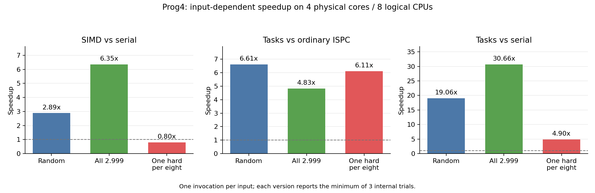

# Prog4 迭代平方根本地实验报告

在四个物理核心、八个逻辑 CPU 的本地配置下，随机输入的普通 ISPC 加速比为 2.89×，tasks ISPC 相对串行的总加速比为 19.06×。将输入全部设为 `2.999f` 后，两者分别提高到 6.35× 和 30.66×；每八个输入中仅保留一个 `2.999f`、其余设为 `1.0f` 后，普通 ISPC 加速比降至 0.80×。结果体现了同一 SIMD 组内迭代次数差异对效率的影响。

## 实验条件

- 实验日期为 2026-11-14，使用本地 Intel Xeon Gold 6330，不使用 Stanford myth 机器。
- 按 `taskset -c 0-3,56-59 ./sqrt` 运行，限制为 socket 0 的四个物理核心、八个逻辑 CPU，并非使用整机全部核心。普通 ISPC 阶段为单个调用线程，可在允许的 CPU 间迁移。
- 共用任务运行时已按 CPU 亲和性适配；此配置创建七个工作线程，主线程也参与执行任务。64 个任务由线程池调度，不创建 64 个线程。
- 输入数量为 2000 万，初始平方根倒数猜测为 `1.0f`。迭代误差阈值为 `1e-5`，最终结果按与数学库平方根的绝对误差 `1e-4` 检查。
- C++ 保留 `-m64 -march=native -O3`；ISPC 保留 `-O3 --target=avx2-i32x8 --arch=x86-64 --pic`，使用八路 SIMD。
- 每种输入仅独立启动一次程序；程序内部每个版本运行三次，报告最短耗时。输入生成、参考答案计算和结果校验均在计时之外。三份日志均未报告 `Error:`。
- 服务器使用动态频率，实验未独占核心。系统负载和调度仍可能影响单次结果。

## 输入和测量结果

三种输入仅修改 `main.cpp` 的 `values[i]` 赋值，计算内核和任务划分保持不变。

| 输入 | 赋值表达式 | 原始日志 |
| --- | --- | --- |
| 随机 | `.001f + 2.998f * static_cast<float>(rand()) / RAND_MAX` | [baseline-random.log](logs/baseline-random.log) |
| 相同输入 | `2.999f` | [balanced-constant.log](logs/balanced-constant.log) |
| 每八个一个困难输入 | `(i % 8 == 0) ? 2.999f : 1.0f` | [divergent-one-in-eight.log](logs/divergent-one-in-eight.log) |

| 输入 | 串行耗时 ms | 普通 ISPC 耗时 ms | tasks ISPC 耗时 ms |
| --- | ---: | ---: | ---: |
| 随机 | 985.250 | 341.475 | 51.683 |
| 相同输入 | 2532.998 | 398.969 | 82.615 |
| 每八个一个困难输入 | 461.631 | 575.279 | 94.224 |

将串行、普通 ISPC、tasks ISPC 的耗时分别记为 Tserial、Tispc、Ttasks，计算同一次运行内的比值：

| 输入 | SIMD 加速 Tserial/Tispc | 多线程额外加速 Tispc/Ttasks | 总加速 Tserial/Ttasks |
| --- | ---: | ---: | ---: |
| 随机 | 2.89× | 6.61× | 19.06× |
| 相同输入 | 6.35× | 4.83× | 30.66× |
| 每八个一个困难输入 | 0.80× | 6.11× | 4.90× |

三种输入的工作量不同，加速比均使用各自的串行基准。[结构化数据](logs/input-comparison.json) 保存完整比值、实验配置及原始日志的 SHA-256。

## 随机输入的 SIMD 和多核收益

随机输入下，SIMD 加速为 `985.250 / 341.475 = 2.89×`。在普通 ISPC 基础上增加多线程，额外加速为 `341.475 / 51.683 = 6.61×`。二者结合，总加速为 `985.250 / 51.683 = 19.06×`，程序打印的 tasks 加速比包含 SIMD 和多线程两部分收益。

随机输入的收敛速度不同。同一 SIMD 组中，需要更多迭代的通道会延长整组循环，提前完成的通道被屏蔽，因此八路 SIMD 不意味着一定获得八倍加速。

## 相同输入提高 SIMD 加速比

全部使用 `2.999f` 时，各通道从相同猜测开始，执行相同数量的迭代，并同时退出循环，减少了循环内的通道空闲。此输入需要较多迭代，有利于体现计算并行的收益。本次 SIMD 加速从 2.89× 提高到 6.35×，总加速从 19.06× 提高到 30.66×，支持组内工作量一致能改善 SIMD 效率的分析。

多线程额外加速则由 6.61× 降至 4.83×。改善组内 SIMD 效率不保证多线程收益也提高；共享硬件资源、频率和调度都可能影响后者。当前数据不能区分这些因素对下降的具体贡献。

`2.999f` 严格小于 3。若输入恰为 `3.0f`，初始猜测 1 经第一次更新变成 0，此后误差始终为 1，无法满足停止条件。

## 每组一个困难输入降低 SIMD 加速比

每连续八个输入排列为 `[2.999, 1, 1, 1, 1, 1, 1, 1]`。对输入 1，初始猜测已经满足 `guess * guess * x == 1`，无需执行牛顿迭代；只有困难输入需要反复更新。按当前一维循环的八路分组，大部分完整组在循环体中只有一个有效通道。

假设困难输入需要 K 次迭代，串行对这八个元素总共进行 K 次迭代，SIMD 也要执行 K 轮循环，但每轮仅有一个有效通道。循环体的有效通道比例约为 1/8，其他通道不会自动接入下一批输入。这符合 ISPC 的[循环控制流与执行掩码模型](https://github.com/ispc/ispc/blob/main/docs/ispc.rst#control-flow-example-loops)。这里的比例描述通道利用率，不能直接代替整程序加速比。

普通 ISPC 实测加速为 `461.631 / 575.279 = 0.80×`，其耗时比串行多约 24.62%。有效计算并行度很低，同时仍有掩码和循环控制等开销，因此向量实现可能慢于串行。当前日志未量化各类开销的比例。

任务之间仍能并行，各任务分到的困难输入数量接近；tasks 相对普通 ISPC 仍有 6.11× 加速，相对串行有 4.90× 总加速。这说明 SIMD 组内的效率与跨线程的并行收益是两个不同层次。

## 实验范围与选做

在这三种已测输入中，相同输入取得最高加速比，每八个一个困难输入取得最低普通 ISPC 加速比。每种输入仅有一次独立运行，不能据此证明所有输入中的全局最大值或最小值。

Prog4 三项必做实验及对应分析已完成。手写 AVX2 intrinsics 的加分题尚未实现。
