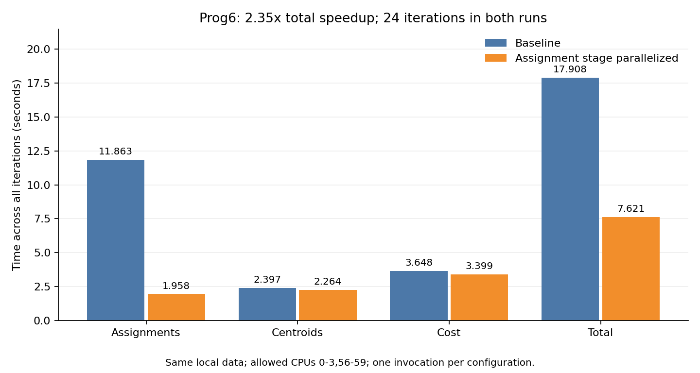

# Prog6 K-Means 本地实验报告

基准测量表明，分配组号的 `computeAssignments()` 占总耗时的 66.25%。仅将这个阶段改为按数据点分块，由七个新线程和主线程共同计算后，完整聚类耗时从 17907.873 ms 降至 7621.219 ms，本次总加速为 2.35×，达到题目约 2.1× 的参考目标。两次均执行 24 轮，初始和最终抽样日志分别逐字节一致。

## 实验条件

- 实验日期为 2026-11-14，使用本地 Intel Xeon Gold 6330。整机为双路、56 个物理核心、112 个逻辑 CPU；本实验按 `taskset -c 0-3,56-59` 限制到 socket 0 的四个物理核心、八个逻辑 CPU。
- 基准算法为单线程。优化版仅在分配组号阶段使用八个执行线程，其他阶段仍顺序执行。
- 使用本地合成数据，复用课程 `main.cpp` 的数据生成函数和备用生成流程，没有使用 Stanford 官方数据。M=1000000、N=100、K=3、epsilon=0.1。
- `rand()` 种子为 7；正态引擎保留默认构造，噪声均值为 0、标准差为 0.5。生成器内部使用十个参考中心，与算法要求的三个聚类中心含义不同。
- 数据文件为 804002420 字节，SHA-256 为 `633b9395f15de5616929f9c84dd05ebed3ef0af51e55127b658b9673f5dbc1a8`。完整配置和生成时的源文件校验值见 [data-metadata.json](logs/data-metadata.json)。
- 使用 g++ 13.3.0，保留 `-m64 -march=native -O3 -Wall`，链接 pthread。没有使用 ISPC，也没有更改编译优化参数。
- 每个版本仅独立启动一次程序。一次启动执行一次完整聚类；24 轮是算法迭代次数，不是重复性能测量。
- 两版使用相同阶段计时方式，报告各阶段全部迭代的累计墙钟耗时。总耗时包含 `kMeansThread()` 内部的准备、计算、线程创建与 join、释放及诊断输出，不含数据读取和起止抽样日志写入。
- 服务器使用动态频率，实验未独占核心，单次结果不能用于估计稳定性或置信区间。

## 根据基准选择热点

在不改变算法和工作划分的计时基准中，三个阶段分别为：

| 阶段 | 累计耗时 ms | 占总耗时 |
| --- | ---: | ---: |
| 分配组号 | 11863.496 | 66.25% |
| 更新中心 | 2396.644 | 13.38% |
| 计算代价 | 3647.710 | 20.37% |

原始日志见 [baseline/run.log](logs/baseline/run.log)，占比图见 [stage-times.png](logs/baseline/stage-times.png)。因此选择只并行化 `computeAssignments()`。

原函数外层遍历中心、内层遍历全部点，使用长度为 M 的辅助数组保存每点的最近距离。所有中心都会更新同一份组号数组，直接并行这些更新会产生竞争。每个点选择最近中心的过程可以独立完成，因此按数据点划分工作更适合本题。

若固定其他部分的基准耗时，分配阶段快 q 倍时，总耗时可估算为 `6.044 + 11.863 / q` 秒。按这个模型，总加速达到 2.1× 需要分配阶段约 4.78× 加速；即使该阶段耗时趋于零，总加速也只约 2.96×。这些是固定其他耗时的规划模型，不是硬件上限。

## 按数据点分配线程

新增 `computeAssignmentsWorker()`，每次处理点编号区间 `[startPoint, endPoint)`。工作函数以点为外层循环，对每个点使用局部的 `minDist` 和 `bestAssignment`，按原顺序检查全部候选中心，最后写入该点的组号。距离计算和严格小于的比较规则保持不变，等距时仍保留先遇到的中心。

`computeAssignments()` 把 M 个点划成八个相邻区间，边界为 `floor(M*t/8)` 和 `floor(M*(t+1)/8)`。七个新线程处理第 1 至第 7 块，主线程处理第 0 块，再 join 全部新线程后返回。相邻区间不重叠且完整覆盖数据，不要求 M 能被八整除。

所有线程共享只读的数据点和中心，分别写自己的组号区间，局部最近距离也不共享。join 保证更新中心阶段开始前，全部组号已经计算完成。每次调用都创建和回收七个新线程，相应开销包含在分配阶段计时中。

这次改动同时调整了循环顺序、去掉约 8 MB 的辅助距离数组，并增加多线程并行。同一个点的坐标连续用于各中心的距离计算。没有单独测量这些因素的贡献，报告的收益是合计收益。

计算源码仅修改 `kmeansThread.cpp`。`dist()`、`computeCentroids()`、`computeCost()`、`stoppingConditionMet()` 及外层迭代函数与已测计时基准逐字一致，`kMeansThread()` 的接口保持不变。

## 实测结果

| 阶段 | 基准耗时 ms | 优化耗时 ms |
| --- | ---: | ---: |
| 分配组号 | 11863.496 | 1958.408 |
| 更新中心 | 2396.644 | 2264.148 |
| 计算代价 | 3647.710 | 3398.645 |
| 整个聚类调用 | 17907.873 | 7621.219 |

分配阶段加速为 `11863.496 / 1958.408 = 6.06×`。总加速为 `17907.873 / 7621.219 = 2.35×`，总耗时降低约 57.44%。

优化后，分配阶段占总耗时的 25.70%，更新中心占 29.71%，计算代价占 44.59%。其余阶段仍占较大比例，因此整个程序的加速低于分配阶段的加速。

更新中心和计算代价的代码没有改变，但本次耗时也略有下降。频率、调度和前一阶段留下的缓存状态都可能影响这些时间；单次测量无法区分具体贡献，不将这些差值全部归因于并行优化。

原始记录、源码快照和可执行程序保存在 [baseline](logs/baseline/) 与 [threaded8](logs/threaded8/)。[comparison.json](logs/comparison.json) 保存完整比值、阶段占比及数据、源码、二进制和日志的校验值。

## 正确性检查与测量范围

同一测试程序分别编译原始计时基准与并行实现。640 组分配状态覆盖零点数、少于八个点、无法整除八的点数、1/2/8/100 维、不同中心数量、等距中心、中心子范围、空中心范围及重复调用；结果逐字节一致。三个完整聚类小样例的最终组号、中心坐标原始字节和收敛轮数也一致。

上述检查在 ASan、UBSan 下通过，使用正式 `-O3 -march=native` 参数时也通过。记录见 [correctness.log](logs/threaded8/correctness.log)，测试源码为 [check-assignments.cpp](logs/check-assignments.cpp)。

完整规模的两次运行均执行 24 轮。`start.log` 分别包含 9929 个抽样点，`end.log` 分别包含 9915 个抽样点，各含三个中心；两版对应日志逐字节一致，检查记录见 [output-comparison.log](logs/threaded8/output-comparison.log)。这些日志只覆盖约 1% 的点，中心以默认文本精度保存，因此不等同于对全部 100 万个组号和中心原始字节的逐元素比较。

使用原始 `plot.py` 生成了 [初始图](logs/threaded8/start.png) 和 [最终图](logs/threaded8/end.png)，图片与基准版本逐字节一致，已检查。图像是 100 维数据的二维 PCA 投影，用于直观检查，不用二维距离证明每个点在原空间中属于最近中心。

本次在既定本地数据和硬件条件下达到约 2.1× 的参考目标，保留只并行化一个阶段的实现。性能结论对应每配置一次独立运行，不表示在其他数据、服务器负载或 Stanford myth 环境中会获得相同加速比。
