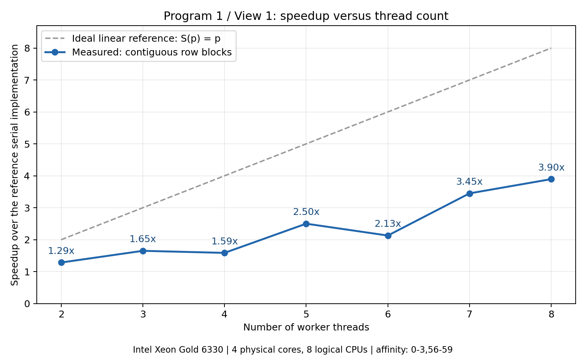
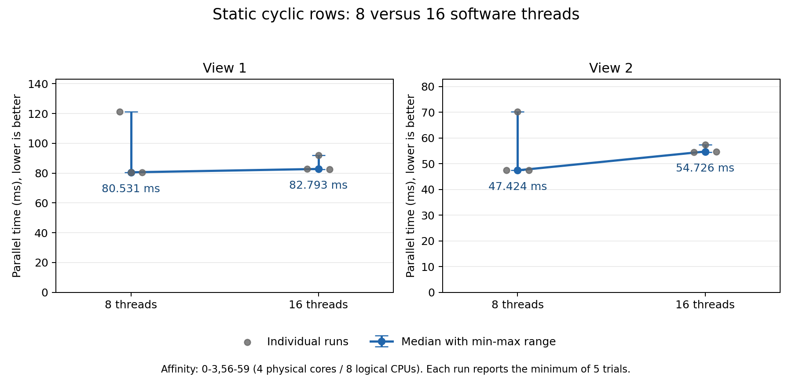
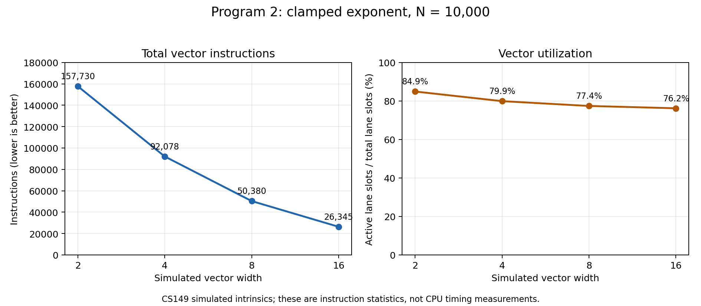
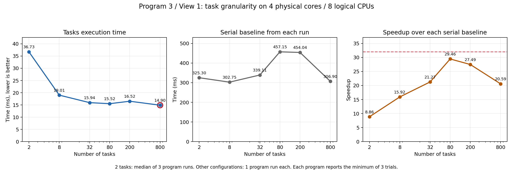
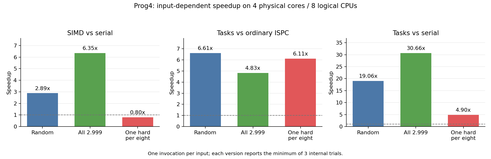
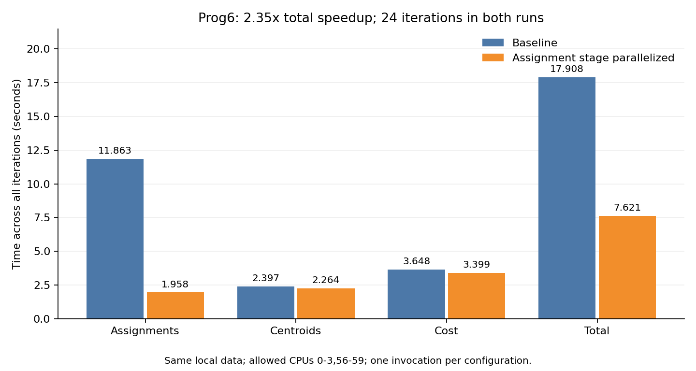

# CS149 作业 1 本地实验报告

本作业使用本地 Xeon Gold 6330 完成线程并行、SIMD、ISPC tasks、访存分析和 K-Means 热点优化实验。多线程性能实验限制在四个物理核心、八个逻辑 CPU 上。Prog1 两个视图达到约 7–8×，Prog6 在本地合成数据上达到 2.35×；Prog3 已测配置均未达到题目 32× 的参考值。

## 实验条件

- 整机为双路 Intel Xeon Gold 6330，共 56 个物理核心、112 个逻辑 CPU。多线程实验使用 `taskset -c 0-3,56-59`；`0/56`、`1/57`、`2/58`、`3/59` 为四对同核超线程。Prog3 第一部分的单线程 SIMD 实验单独固定到 CPU 0。
- 工具为 Linux x86-64、g++ 13.3.0、GNU Make 4.3、ISPC 1.28.1。Prog3–5 保留 AVX2 八路 SIMD 目标。
- 本机使用动态频率，实验没有独占 CPU。加速比使用同一次程序运行的基准与优化耗时计算，不跨运行拼接基准。
- Prog1 最终八线程、十六线程实验，以及 Prog3 原始两任务基线，每配置独立启动三次。其余后续性能配置仅独立启动一次。Prog1 程序内部测五次取最短值；Prog3–5 内部测三次取最短值；Prog6 每次启动只执行一次完整聚类。
- Prog6 使用复用课程生成逻辑的本地合成数据，M=1000000、N=100、K=3、epsilon=0.1，未使用 Stanford 官方数据。


## 实验结果总览

| 程序 | 实测结果 | 完成范围 |
| --- | --- | --- |
| Prog1 线程 Mandelbrot | 八线程相对串行加速比中位数：View 1 为 7.28×，View 2 为 7.04× | 五项要求的实现、诊断、图表和分析已整理 |
| Prog2 模拟 SIMD | 宽度 2→16，利用率 84.9%→76.2%，模拟向量指令数 157730→26345 | 截断幂、宽度实验及选做数组求和已完成 |
| Prog3 ISPC Mandelbrot | View 1 的 800 tasks 耗时 14.903 ms，同次相对串行 20.59× | SIMD 与任务粒度分析已完成；32× 参考值未达到 |
| Prog4 迭代平方根 | 随机输入：普通 ISPC 相对串行 2.89×，tasks 总加速 19.06× | 三种输入实验已完成；手写 AVX2 选做未实现 |
| Prog5 SAXPY | 普通 ISPC 21.485 ms，tasks 7.105 ms，额外加速 3.02× | 基准、性能分析和流量乘四的解释已完成；性能优化选做未实现 |
| Prog6 K-Means | 分配阶段 6.06×，完整聚类 2.35× | 仅并行化分配阶段，在本地合成数据上完成测量与校验 |

各行比较的基准不同：Prog2 统计模拟指令，Prog5 比较两种已向量化的实现，其余表中注明相对串行或基准实现。不同程序的加速比不直接代表同一种并行效率。

## 性能分析的共同结论

Prog1 表明，分到相同数量的像素不意味着获得相同计算量。交错行分配将复杂区域分散给各线程，减少等待最慢线程的时间；十六个软件线程仍只能使用既定的四个物理核心和八个逻辑 CPU。

Prog2、Prog3 和 Prog4 表明，SIMD 组内各元素的工作量差异会产生空闲通道。Prog4 每八个输入中只有一个困难输入时，普通 ISPC 仅为串行的 0.80×，说明向量化本身不保证加速。ISPC 的普通 `foreach` 使用调用线程的 SIMD 执行资源，`launch` 才把任务交给运行时在多个线程上调度。

Prog5 每个元素只有两次浮点运算，按作业流量模型需搬运 16 字节，运算强度为 0.125 FLOP/byte。共享内存系统会限制增加线程的收益；本次未通过独立带宽基准或硬件计数器确定是否已经饱和。

Prog6 体现 Amdahl 定律：若原程序中可加速阶段占比为 f，该阶段快 q 倍，且其他耗时保持不变，则总加速为 `1 / ((1-f) + f/q)`。基准分配阶段占 66.25%，即使其耗时趋于零，该模型的总加速也只约 2.96×。优化后应重新查看各阶段占比，识别新的瓶颈。

## 报告与提交格式

以下六节保留各题报告的正文、数据和图表；各目录中的原始 `REPORT.md` 也保留。本文用于本地自学记录，未验证 Stanford myth 环境。


## Prog1：使用线程并行生成 Mandelbrot 图像


### 实验条件与测量方法

- 服务器 CPU 为 Intel Xeon Gold 6330，整机有两个插槽、56 个物理核心、112 个逻辑 CPU。
- 本实验始终通过 `taskset -c 0-3,56-59` 限制在同一组四个物理核心、八个逻辑 CPU 上。逻辑 CPU 配对为 `0/56`、`1/57`、`2/58`、`3/59`。
- 使用 Linux x86-64、g++ 13.3.0 和 GNU Make 4.3；沿用 Makefile 的 `-m64 -O3 -std=c++11` 等编译参数。
- 图像大小为 1600×1200，最大迭代次数为 256。两个视图分别测量，均以课程提供的串行实现为基准。
- 每次启动程序，串行与并行实现分别运行五次，各取最短时间。单次加速比为 `S(p) = Tserial / Tparallel(p)`，使用同一次程序运行中的两个耗时。
- 最终八线程和十六线程的每种视图配置各启动程序三次，保留全部原始数据，分别报告并行耗时与单次加速比的中位数。
- 所列各次程序运行均通过内置串行与并行输出一致性校验。最终测量已移除逐线程诊断计时与打印。
- 服务器采用动态频率，实验没有独占 CPU。原始记录存在明显波动，报告保留这些现象。

### 1. 两线程空间分解

首先使用连续行分块，将图像上半部分交给线程 0，下半部分交给线程 1。线程 0 由主线程直接执行，另创建一个 `std::thread` 执行线程 1，计算结束后通过 `join()` 等待完成。

推广到 `p` 个线程时，线程 `t` 的行范围为：

```text
startRow = height * t / p
endRow   = height * (t + 1) / p
```

处理区间是 `[startRow, endRow)`。在本实验的两线程配置下，两个线程分别计算第 0–599 行与第 600–1199 行。相邻分块的边界一致，即使图像高度不能整除线程数，也不会遗漏行。

两个视图的两线程结果均通过串并行输出一致性检查。

### 2. 连续分块的加速比曲线

原始数据见 [block-view1.log](prog1_mandelbrot_threads/logs/block-view1.log)。该轮 View 1 加速比如下：

| 线程数 | 2 | 3 | 4 | 5 | 6 | 7 | 8 |
| --- | --- | --- | --- | --- | --- | --- | --- |
| 加速比 | 1.29× | 1.65× | 1.59× | 2.50× | 2.13× | 3.45× | 3.90× |



加速比没有随线程数线性增长，原始曲线还在四线程与六线程处出现回退。平均分配行数只能使各线程获得相近数量的像素，但像素需要的迭代次数不同。因此，连续分块可能造成计算负载不均，整体运行时间受最慢线程限制。

三线程尤其容易暴露这个问题：三个线程各处理 400 行，中间那块可能包含更多需要较多迭代的像素。四个物理核心上的八个逻辑 CPU 也共享部分硬件资源，不能预设线程数翻倍就一定使速度翻倍。

后续完整逐线程测量中，四线程和六线程的回退没有稳定重现。因此，负载不均可以解释并行效率受限，但当前证据不足以将原曲线的每一个回退都归因于分块策略。

### 3. 使用逐线程计时检验假设

在 `workerThreadStart()` 入口记录开始时刻，完成计算后记录结束时刻，将两者之差保存到该线程自己的参数记录。所有工作线程完成后，由主线程统一打印耗时。

[三线程诊断日志](prog1_mandelbrot_threads/logs/block-view1-t3-timing.log)的第 4 轮结果为：

| 线程 | 行范围 | 耗时 / ms |
| --- | --- | --- |
| 0 | 0–399 | 177.918 |
| 1 | 400–799 | 355.478 |
| 2 | 800–1199 | 124.363 |

五轮中线程 1 始终最慢，符合中间区域所在的线程成为瓶颈的判断。线程 0 和线程 2 完成后不能处理线程 1 剩余的任务，程序必须等待它完成。整体并行耗时大致由最慢线程的耗时及线程管理开销决定。

[2–8 线程的完整诊断日志](prog1_mandelbrot_threads/logs/block-view1-thread-timing.log)也体现了中间区域与边缘区域的耗时差异。例如八线程第 5 轮，线程 0 与线程 7 分别只需 11.138 ms、11.276 ms，而线程 3 与线程 4 分别需要 143.203 ms、144.147 ms。

这些结果支持连续分块存在负载不均的解释。不过，测量的是实际经过时间，也包含调度与资源竞争的影响，不能仅凭耗时精确区分纯计算量与系统因素。

### 4. 改进为静态交错行分配

最终实现让线程 `t` 处理以下各行，其中 `p` 是线程总数：

```text
t, t+p, t+2p, ...，直到行号达到图像高度
```

对应代码为：

```cpp
for (unsigned int row = args->threadId;
     row < args->height;
     row += args->numThreads) {
    mandelbrotSerial(
        args->x0, args->y0, args->x1, args->y1,
        args->width, args->height,
        row, 1,
        args->maxIterations,
        args->output);
}
```

每次调用计算一行，同时保留整张图像的宽高，以正确计算像素在复平面中的坐标。交错分配使每个线程都能处理图像上、中、下部的行，有助于分散高迭代区域的工作。

每行 `r` 唯一归属于线程 `r % p`，因此所有行恰好处理一次，不同线程写入不同的行。工作线程之间不需要增加锁、共享任务计数器或通信；使用起始代码中的 `join()` 等待完成。同一个分配公式适用于不同线程数与两个视图，没有为单独配置硬编码。

最终八线程结果为：

| 视图 | 三次单次加速比 | 加速比中位数 | 并行耗时中位数 / ms |
| --- | --- | --- | --- |
| View 1 | 4.83×、7.28×、7.29× | 7.28× | 80.531 |
| View 2 | 7.04×、4.79×、7.08× | 7.04× | 47.424 |

两个视图的加速比中位数均达到题目约 7–8× 的参考目标。每组均出现一次约 4.8× 的慢样本，全部数据均已保留。连续分块与最终交错分配的数据来自不同批次，不将所有耗时变化都归因于算法改进。

### 5. 十六线程与八线程比较



图中保留三次独立运行的原始点，并标出中位数和最小值至最大值的范围。每个原始点仍是一次程序内部五次并行测量的最短时间。

| 视图 | 八线程耗时中位数 / ms | 十六线程耗时中位数 / ms | 耗时变化 |
| --- | --- | --- | --- |
| View 1 | 80.531 | 82.793 | 增加约 2.8% |
| View 2 | 47.424 | 54.726 | 增加约 15.4% |

本次实验没有观察到十六线程进一步提速。两种线程配置都限制在同样的四个物理核心、八个逻辑 CPU 上，更多软件线程没有增加可用的硬件执行位置。额外的线程创建、调度和资源竞争等成本可能抵消任务进一步细分的收益。本实验没有单独量化这些成本，且样本较少，不据此声称 View 1 约 2.8% 的差异具有统计显著性。

View 1 的某次十六线程日志显示 10.99×，但对应串行基准为 909.805 ms，明显慢于另两次约 587 ms 的基准。该次并行耗时为 82.793 ms，并未快于八线程的两次约 80 ms 结果。因此，判断增加线程是否有收益时，应比较并行耗时，并同时检查串行基准是否发生变化。

## Prog2：使用模拟 SIMD 指令计算截断幂与数组求和

本报告记录必做截断幂与选做数组求和。使用课程提供的 CS149 模拟向量指令，性能指标为模拟指令数量与向量通道利用率。硬件、软件及本地实验条件见 [LOCAL_EXPERIMENTS.md](LOCAL_EXPERIMENTS.md)。


### 向量宽度实验

固定 `N=10000` 和计算实现，只改变 `CS149intrin.h` 中的 `VECTOR_WIDTH`，每次修改后通过 `make` 重新编译，再执行 `./myexp -s 10000`。四种宽度的必做结果校验均通过。

| 向量宽度 | 总向量指令数 | 向量利用率 | 活动通道位置数 | 总通道位置数 | 原始日志 |
| --- | --- | --- | --- | --- | --- |
| 2 | 157730 | 84.9% | 267972 | 315460 | [width2-n10000.log](prog2_vecintrin/logs/width2-n10000.log) |
| 4 | 92078 | 79.9% | 294404 | 368312 | [width4-n10000.log](prog2_vecintrin/logs/width4-n10000.log) |
| 8 | 50380 | 77.4% | 311780 | 403040 | [width8-n10000.log](prog2_vecintrin/logs/width8-n10000.log) |
| 16 | 26345 | 76.2% | 321044 | 421520 | [width16-n10000.log](prog2_vecintrin/logs/width16-n10000.log) |



### 为什么利用率下降

每个元素的指数不同，因此需要执行的乘法次数不同。向量循环必须持续到本组最后一个通道完成；提前完成的通道在后续乘法与计数递减指令中被掩码关闭。组越宽，组内出现较大指数的机会越高，更多较早完成的通道需要等待，导致这些操作的活动通道比例降低。

例如指数 `[1,1,1,9]` 对应剩余乘法次数 `[0,0,0,8]`，后续八轮乘法均只有最后一个通道活动。更窄的向量可以将不同元素分成更多独立的组，各组分别结束自己的循环。

这个现象也可以从当前实现的指令数推算。令组数为 `B=N/VECTOR_WIDTH`，第 `g` 组执行 `M_g` 次乘法循环。当前函数有 6 条一次性初始化指令、每组 11 条固定指令，以及每轮循环 4 条指令，因此：

```text
I = 6 + 11*B + 4*sum(M_g)
```

四条循环指令分别为乘法、计数递减、活动条件比较，以及下次循环条件中的 `cntbits`。按日志中的指令总数推算，宽度 2、4、8、16 每组平均循环次数分别为约 5.14、6.46、7.32、7.79，体现较宽分组更容易由较长的循环决定完成时间。

`10000` 能被四种宽度整除，因此本次利用率下降不来自尾部不足一个向量宽度。模拟器的整体利用率为累计活动通道位置除以累计总通道位置；它也统计比较、`cntbits` 等操作，不能直接等同于乘法指令的利用率。

### 为什么指令数仍然减少

宽度增加后，同一条指令可以处理更多元素，组数由 5000 减少到 625。虽然每组平均循环次数增加、部分通道需要等待，整体模拟指令数仍由 157730 降至 26345。

### 选做：向量求和与归约

`arraySumVector()` 使用题目允许的前提：`N` 为向量宽度的整数倍，向量宽度为 2 的幂。

第一阶段按向量宽度遍历输入，每次加载一组并累加到同一个向量的对应通道。例如宽度为 4、输入为 1–8 时，累加向量最终为 `[6,8,10,12]`。

第二阶段重复执行相邻求和 `hadd` 和偶奇重排 `interleave`。`hadd` 将每对相邻通道的和分别写入两个位置，`interleave` 把偶数下标移到前半部分，使不同的部分和在下一轮相邻。示例依次得到 `[14,14,22,22]`、`[14,22,14,22]`、`[36,36,36,36]`，最后返回第 0 个通道的值。

`hadd` 使用临时输出向量，再以该临时向量为输入执行 `interleave`，避免重排时覆盖仍需读取的输入。每轮后独立部分和数量减半，执行 `log2(VECTOR_WIDTH)` 轮即可完成归约。

按题目将向量操作视为常数步的模型，两阶段分别需要 `O(N/VECTOR_WIDTH)` 和 `O(log2(VECTOR_WIDTH))` 个步骤，合计为：

```text
O(N/VECTOR_WIDTH + log2(VECTOR_WIDTH))
```

在临时副本中，对宽度 1、2、4、8、16 各执行 18 个精确求和案例，共 90 个案例，ASan/UBSan 均通过，见 [array-sum-proposed-check.log](prog2_vecintrin/logs/array-sum-proposed-check.log)。用户随后已将该实现写入作业文件；宽度 16、`N=10000` 的实际程序运行中，必做截断幂与选做数组求和均显示 `Passed!!!`，见 [array-sum-n10000.log](prog2_vecintrin/logs/array-sum-n10000.log)。

浮点求和改变了加法分组，结果可能与串行累加有舍入差异，实际程序按约 0.2 的绝对误差阈值校验。主程序在调用选做求和前已打印向量统计，因此上述宽度实验的统计只涵盖必做部分。另外，辅助函数 `hadd` 与 `interleave` 当前没有调用日志记录器，归约复杂度依据算法结构分析。

## Prog3：使用 ISPC 生成 Mandelbrot 图像

本报告记录本地实验结果，不使用 Stanford myth 机器。完整硬件与工具版本见 [LOCAL_EXPERIMENTS.md](LOCAL_EXPERIMENTS.md)。

### 第一部分：单线程 SIMD

#### 实验条件

- 本机 CPU 为 Intel Xeon Gold 6330；本部分按指导命令通过 `taskset -c 0` 固定到逻辑 CPU 0。
- 图像大小为 1200×800，最大迭代次数为 256，两个视图分别测量。
- 使用 ISPC 1.28.1，保留 Makefile 的 `--target=avx2-i32x8` 八通道目标；C++ 使用 `-O3 -ffp-contract=off`，ISPC 使用 `-O3 --opt=disable-fma` 等原有参数。
- 程序不带 `--tasks`。普通 ISPC 函数通过单个调用线程执行 SIMD 代码，不会因为八通道而创建八个操作系统线程。
- 每个视图启动程序一次；串行与 ISPC 实现各运行三次，报告各自最短时间，加速比使用同次程序运行中的串行耗时除以 ISPC 耗时。
- 服务器采用动态频率，CPU 没有独占。当前两份日志不能反映同一视图重复启动程序的波动范围。

#### 结果

| 视图 | 串行耗时 / ms | ISPC 耗时 / ms | 加速比 | 原始日志 |
| --- | --- | --- | --- | --- |
| View 1 | 312.327 | 62.185 | 5.02× | [view1/ispc.log](prog3_mandelbrot_ispc/logs/view1/ispc.log) |
| View 2 | 271.512 | 63.887 | 4.25× | [view2/ispc.log](prog3_mandelbrot_ispc/logs/view2/ispc.log) |

两次运行均打印了结果校验之后的加速比，未报告不一致。两个视图目录中的串行与 ISPC PPM 文件也分别逐字节一致，图像尺寸均为 1200×800。

#### 理想加速比与实际差距

按题目给出的简化模型，在标量与八通道向量指令吞吐能力相当、各通道充分利用等理想条件下，单线程 SIMD 的预期加速比约为 8×。这是题目的比较模型，不能直接视为本地处理器所有输入下的严格上限。

Mandelbrot 的不同像素需要不同迭代次数。ISPC 的 varying `break` 使满足逃逸条件的实例退出当前循环，其余实例继续；执行掩码控制后续运算对哪些实例生效。某一组必须持续执行，直到最后一个仍参与计算的实例也结束，较早完成的实例便无法继续贡献该组的运算。

最需要关注的是集合边界附近的混合区域：一组相邻像素中，有的很快逃逸，有的迭代很久甚至达到上限，导致控制流分歧。相反，一组像素如果都很快结束，或都执行到 256 次，控制流较一致。计算量大的亮区域不一定就具有较低的 SIMD 效率，关键是同组像素的工作量差异。

实际代码还需要执行比较、掩码处理、循环控制、地址计算和结果存储等操作。再加上真实处理器的频率、吞吐与共享资源条件，不能假设程序一定获得理想的八倍加速。

#### 两个视图的比较

View 2 的串行耗时低于 View 1，但 ISPC 耗时略高，表明本次测量中 SIMD 耗时没有与串行总计算量同比例变化。两个视图中像素迭代次数的空间分布不同，可能改变组内控制流一致性，因而影响加速效果。

这组结果与控制流分歧的解释一致，但没有采集实际通道活跃度、指令数或频率数据，不能把两个加速比的全部差异确定归因于某一个因素，也不能把加速比除以 8 直接称为实测通道利用率。

### 第二部分：ISPC tasks

#### 本地运行时适配

在正式测量前，调整了第 3–5 题共用的 `common/tasksys.cpp` 中 Linux 默认 pthread 后端的线程池规模。原实现按 `sysconf(_SC_NPROCESSORS_ONLN)-1` 创建工作线程，本机得到 111，即便进程通过 `taskset` 仅允许使用八个逻辑 CPU，仍然会创建 111 个工作线程。

适配后通过 `sched_getaffinity()` 获取初始化线程允许使用的 CPU 集合，使用 `CPU_COUNT()` 统计数量，创建比该数量少一个的工作线程；主线程在 `Sync()` 中也可以取任务执行。只有一个允许的 CPU 时，创建零个工作线程，保留初始化标记，由主线程处理任务。

这是本地实验环境适配。适配线程池时，`mandelbrot_ispc_withtasks()` 中的两个任务和每任务 400 行保持不变；随后任务划分优化仅修改该启动函数。

新增 [tasksys_affinity.cpp](common/tests/tasksys_affinity.cpp) 检查实际操作系统线程数，并通过运行时连续提交两轮、每轮 257 个任务，确认各任务恰好完成一次。适配前，在八 CPU 亲和性下观察到 112 个进程线程，检查失败；适配后，允许 1、2、8 个 CPU 时实际线程数分别为 1、2、8，检查全部通过。日志见 [适配前](prog3_mandelbrot_ispc/logs/affinity-regression-before.log)、[适配后](prog3_mandelbrot_ispc/logs/affinity-regression-after.log)。

#### 原始两任务配置的基线

- 固定 CPU 集合 `0-3,56-59`，对应四个物理核心、八个逻辑 CPU；七个工作线程加参与执行的主线程。
- 图像 1200×800，最大迭代次数 256，ISPC 八通道目标保持不变。
- 每个视图独立启动三次程序，每次使用 `--tasks`，程序内部串行、普通 ISPC、tasks 各运行三次取最短值。
- 每次运行均采样检查 `/proc/<pid>/task`，观察到最多八个操作系统线程，并检查这些线程的允许 CPU 集合符合约束。
- 六次运行均通过主程序的两个输出校验，三种实现生成的 PPM 在每次运行中逐字节一致。每个视图目录的 PPM 保留该视图最后一次运行的结果。
- 构建日志见 [tasks-baseline-build.log](prog3_mandelbrot_ispc/logs/tasks-baseline-build.log)，结构化数据见 [tasks2-summary.json](prog3_mandelbrot_ispc/logs/tasks2-summary.json)。

| 视图 | 轮次 | 串行 / ms | 普通 ISPC / ms | 两任务 / ms | 相对串行加速 | 相对普通 ISPC 加速 | 原始日志 |
| --- | --- | --- | --- | --- | --- | --- | --- |
| 1 | 1 | 323.820 | 64.394 | 45.862 | 7.06× | 1.40× | [run1](prog3_mandelbrot_ispc/logs/tasks2-view1/run1.log) |
| 1 | 2 | 325.297 | 64.858 | 36.650 | 8.88× | 1.77× | [run2](prog3_mandelbrot_ispc/logs/tasks2-view1/run2.log) |
| 1 | 3 | 325.300 | 64.938 | 36.728 | 8.86× | 1.77× | [run3](prog3_mandelbrot_ispc/logs/tasks2-view1/run3.log) |
| 2 | 1 | 187.901 | 46.356 | 28.141 | 6.68× | 1.65× | [run1](prog3_mandelbrot_ispc/logs/tasks2-view2/run1.log) |
| 2 | 2 | 188.590 | 44.479 | 29.100 | 6.48× | 1.53× | [run2](prog3_mandelbrot_ispc/logs/tasks2-view2/run2.log) |
| 2 | 3 | 189.051 | 44.815 | 26.492 | 7.14× | 1.69× | [run3](prog3_mandelbrot_ispc/logs/tasks2-view2/run3.log) |

分别对三个耗时和三个单次比值取中位数，结果如下。每个比值使用同一次 `--tasks` 运行中的耗时计算，第一部分固定 CPU 0 的旧数据不参与这些比值。

| 视图 | 两任务耗时中位数 / ms | 相对串行加速中位数 | 相对普通 ISPC 加速中位数 |
| --- | --- | --- | --- |
| View 1 | 36.728 | 8.86× | 1.77× |
| View 2 | 28.141 | 6.68× | 1.65× |

原始配置只有两个独立的图像任务，即使运行时有八个可参与工作的线程，也最多有两个任务同时计算图像。后续增加任务数，把图像拆成更多块，让更多执行线程参与，并比较任务粒度与调度开销的影响。

#### 八任务初测：View 1

用户将启动函数改为 `numTasks=8`、`rowsPerTask=height/numTasks`、`launch[numTasks]`，任务函数与运行时保持不变。每个任务负责 100 行。按用户选择，每个新配置只独立启动一次程序，程序内部各实现仍测三次取最小值。

| 任务数 | 串行 / ms | 普通 ISPC / ms | tasks / ms | 相对串行加速 | 相对普通 ISPC 加速 |
| --- | --- | --- | --- | --- | --- |
| 8 | 302.747 | 60.889 | 19.013 | 15.92× | 3.20× |

原始日志见 [tasks8-view1/run1.log](prog3_mandelbrot_ispc/logs/tasks8-view1/run1.log)。程序通过两个结果校验，三种实现生成的 PPM 逐字节一致。相对于此前两任务的 36.728 ms 中位数，本次 tasks 耗时降低约 48.2%；这是单次新配置与另一批次基线中位数的比较，不能将全部差值精确归因于任务数。

八任务使更多工作线程能够参与，但连续 100 行分块仍可能存在计算量差异。随后测试 32 个任务、每任务 25 行，观察更细粒度是否改善负载分布。

#### 三十二任务初测：View 1

用户只将启动函数的 `numTasks` 改为 32，继续使用相同 CPU 集合与线程池，独立启动程序一次。日志见 [tasks32-view1/run1.log](prog3_mandelbrot_ispc/logs/tasks32-view1/run1.log)。

| 任务数 | 每任务行数 | 串行 / ms | 普通 ISPC / ms | tasks / ms | 相对串行加速 | 相对普通 ISPC 加速 |
| --- | --- | --- | --- | --- | --- | --- | --- |
| 32 | 25 | 339.109 | 67.190 | 15.941 | 21.27× | 4.21× |

两个结果校验均通过，三种实现的 PPM 逐字节一致。相对八任务的单次记录，tasks 耗时减少约 16.2%。两批次串行与普通 ISPC 基准也有变化，比较任务划分时应同时观察绝对 tasks 耗时。

当前尚未达到题目参考的 32×。本次单线程 SIMD 加速为约 5.05×，与四个物理核心相乘的粗略估算约为 20.2×，与 21.27× 的观察值接近。该乘法只是帮助理解现象的估算，不是严格硬件上限；超线程、频率、负载分布及调度开销都可能改变结果。八个逻辑 CPU 不等于八个独立物理核心，不能假设多核阶段必然再获得八倍加速。

在这次 339.109 ms 的串行基准下，32× 对应约 10.597 ms 的 tasks 耗时，实测为 15.941 ms。随后保持硬件条件测试 80 个任务、每任务 10 行，检查是否仍有任务粒度带来的改进空间。尚未确定最优任务数，也不以改变串行基准或扩大 CPU 集合的方式满足参考比值。

#### 八十任务初测：View 1

用户将 `numTasks` 改为 80，每个任务处理 10 行，独立启动程序一次。日志见 [tasks80-view1/run1.log](prog3_mandelbrot_ispc/logs/tasks80-view1/run1.log)。

| 任务数 | 每任务行数 | 串行 / ms | 普通 ISPC / ms | tasks / ms | 相对串行加速 | 相对普通 ISPC 加速 |
| --- | --- | --- | --- | --- | --- | --- | --- |
| 80 | 10 | 457.146 | 91.259 | 15.520 | 29.46× | 5.88× |

两项结果校验通过，三种实现的 PPM 逐字节一致。tasks 耗时相对三十二任务只下降约 2.6%，而该次串行基准比三十二任务那次增加约 34.8%。因此，从 21.27× 到 29.46× 的变化，不能全部当作增加任务数带来的性能提升。当前仍优先按 tasks 绝对耗时比较不同配置。

在本次 457.146 ms 的串行基准下，32× 对应约 14.286 ms 的 tasks 耗时。随后测试 200 个任务（每任务 4 行）与 800 个任务（每任务 1 行），每个配置仍只启动一次。八百任务是当前按完整行等分算法中每任务一行的最细粒度，用于检查继续细分是否仍有收益，或调度开销是否开始抵消收益。未据现有数据认定硬件的严格性能上限。

#### 二百任务、八百任务与配置选择

两个新配置均通过主程序的两项校验，各自三个 PPM 与之前 View 1 的正确图像也逐字节一致。日志见 [tasks200-view1/run1.log](prog3_mandelbrot_ispc/logs/tasks200-view1/run1.log) 和 [tasks800-view1/run1.log](prog3_mandelbrot_ispc/logs/tasks800-view1/run1.log)。

| 任务数 | 每任务行数 | 串行 / ms | 普通 ISPC / ms | tasks / ms | 相对串行加速 | 相对普通 ISPC 加速 |
| --- | --- | --- | --- | --- | --- | --- | --- |
| 200 | 4 | 454.043 | 90.538 | 16.516 | 27.49× | 5.48× |
| 800 | 1 | 306.905 | 90.597 | 14.903 | 20.59× | 6.08× |



结构化汇总见 [task-granularity-view1.json](prog3_mandelbrot_ispc/logs/task-granularity-view1.json)。图中两任务采用此前三次独立运行的各项中位数，其余配置均为一次独立运行，每次程序内部仍各测三次取最短值。

| 任务数 | 每任务行数 | tasks / ms | 相对串行加速 |
| --- | --- | --- | --- |
| 2 | 400 | 36.728 | 8.86× |
| 8 | 100 | 19.013 | 15.92× |
| 32 | 25 | 15.941 | 21.27× |
| 80 | 10 | 15.520 | 29.46× |
| 200 | 4 | 16.516 | 27.49× |
| 800 | 1 | 14.903 | 20.59× |

本次保留 `numTasks=800`，因为它是所测配置中 tasks 绝对耗时最低的一组。其耗时比八十任务低约 4.0%，相比原始两任务耗时中位数缩短约 2.46 倍。每任务一行使任务运行时能够把不同复杂度的行分配给已有工作线程；这种动态领取工作有助于分散粗分块中的计算量差异。

选择依据是本次实测任务耗时，不能据每种配置的一次测量证明八百任务始终优于八十任务，也没有对所有可能的任务数穷举。二百任务出现回退，任务管理开销、调度和运行波动都可能参与影响；没有进一步剖析来单独量化各因素。

八百任务虽然绝对耗时最低，加速比却低于八十任务，因为相应串行基准从 457.146 ms 变成 306.905 ms。不能把较慢配置的串行基准与较快配置的 tasks 耗时拼接成加速比。本地固定四个物理核心、八个逻辑 CPU 的这些记录均未达到 32×，报告保留这一结果，不声称满足参考性能阈值，也不据此认定本机绝不可能达到 32×。

当前实现、单核 SIMD 分析、两任务基线与任务粒度实验均已整理；本地固定硬件条件下的 32× 参考性能阈值尚未达到。

### 选做：任务抽象与线程抽象

这里讨论一般性的思想实验，不将任务数量限制为当前 Mandelbrot 的行数，也未实际创建一万个线程。

#### 执行工作与提供执行载体

任务表示一份待执行的工作；线程是能够执行工作的执行上下文。ISPC 任务通常由运行时工作线程池执行，任务数量可以远多于执行线程数量。当前课程的 pthread 运行时也采用这种组织方式：`ISPCLaunch()` 创建任务描述，任务进入队列，已有工作线程和参与同步的调用线程领取任务。

| 比较项 | ISPC tasks | 常见系统上的 `std::thread` |
| --- | --- | --- |
| 创建的对象 | 可排队的工作及其任务描述 | 一个新的操作系统线程 |
| 主要调度者 | 运行时将任务分给线程，操作系统再调度线程 | 操作系统调度各个线程 |
| 工作完成后 | 执行线程可继续处理其他任务 | 本次线程入口返回后，线程结束 |
| 等待完成 | `sync` 等待当前函数启动的任务完成 | `join()` 等待对应线程结束 |
| 函数返回 | 启动任务的函数返回前有隐式 `sync` | 没有对应的隐式 `join()`，程序需正确管理线程生命周期 |
| 栈与执行状态 | 排队任务保存描述，运行时使用工作线程的执行栈 | 同时存活的线程各有自己的栈与线程管理状态 |

`sync` 不会因为任务完成就销毁线程池，后续任务可以复用执行线程。使用线程也可以自行构建线程池，实现相同的工作排队与复用；任务抽象已经封装了这些机制，将工作数量与执行资源数量分开。

#### 一万个任务

假设可用逻辑 CPU 数量为八，运行时配置八个参与执行的线程。提交一万个任务通常会创建一万个任务描述，由这些执行线程分批领取和运行，而不必创建一万个操作系统线程。任务数量增加不会自动增加硬件并行能力，但能让运行时在任务耗时不同时继续分配剩余工作，改善负载分布。

任务也有分配、排队、同步与调度成本。如果每个任务工作量很小，管理成本可能抵消细分带来的收益，因此任务数量不是越多越好。

#### 一万个线程

创建一万个 `std::thread` 会尝试创建一万个线程；实际同时存活多少取决于它们的执行时间。如果大量 CPU 密集线程同时存活，可用逻辑 CPU 仍只有八个，操作系统需要在大量可运行线程之间调度。线程创建、栈空间和管理状态会消耗资源，线程切换及缓存影响也可能增加成本。创建还可能因资源或系统线程数量限制而失败，见 [Linux pthread_create 文档](https://man7.org/linux/man-pages/man3/pthread_create.3.html)。栈的虚拟地址预留不能直接等同于同等数量的实际物理内存占用。

这不是说所有大量线程场景都没有意义；这里讨论的是大量独立 CPU 计算工作的组织方式。I/O 阻塞、长期服务及其他工作负载有不同需求。

#### 两种并行层次

ISPC 每个任务由一个 gang 执行，任务内部仍可以使用 SIMD。普通线程也可以执行 SIMD 指令或调用 ISPC 函数。因此，任务与线程抽象的区别并不是有无 SIMD，而是工作如何组织、调度和复用执行资源。

ISPC 的 `launch`、显式 `sync` 和函数返回前的隐式同步语义见 [ISPC 用户指南](https://github.com/ispc/ispc/blob/main/docs/ispc.rst)。

## Prog4 迭代平方根本地实验报告

在四个物理核心、八个逻辑 CPU 的本地配置下，随机输入的普通 ISPC 加速比为 2.89×，tasks ISPC 相对串行的总加速比为 19.06×。将输入全部设为 `2.999f` 后，两者分别提高到 6.35× 和 30.66×；每八个输入中仅保留一个 `2.999f`、其余设为 `1.0f` 后，普通 ISPC 加速比降至 0.80×。结果体现了同一 SIMD 组内迭代次数差异对效率的影响。

### 实验条件

- 实验日期为 2026-11-14，使用本地 Intel Xeon Gold 6330，不使用 Stanford myth 机器。
- 按 `taskset -c 0-3,56-59 ./sqrt` 运行，限制为 socket 0 的四个物理核心、八个逻辑 CPU，并非使用整机全部核心。普通 ISPC 阶段为单个调用线程，可在允许的 CPU 间迁移。
- 共用任务运行时已按 CPU 亲和性适配；此配置创建七个工作线程，主线程也参与执行任务。64 个任务由线程池调度，不创建 64 个线程。
- 输入数量为 2000 万，初始平方根倒数猜测为 `1.0f`。迭代误差阈值为 `1e-5`，最终结果按与数学库平方根的绝对误差 `1e-4` 检查。
- C++ 保留 `-m64 -march=native -O3`；ISPC 保留 `-O3 --target=avx2-i32x8 --arch=x86-64 --pic`，使用八路 SIMD。
- 每种输入仅独立启动一次程序；程序内部每个版本运行三次，报告最短耗时。输入生成、参考答案计算和结果校验均在计时之外。三份日志均未报告 `Error:`。
- 服务器使用动态频率，实验未独占核心。系统负载和调度仍可能影响单次结果。

### 输入和测量结果

三种输入仅修改 `main.cpp` 的 `values[i]` 赋值，计算内核和任务划分保持不变。

| 输入 | 赋值表达式 | 原始日志 |
| --- | --- | --- |
| 随机 | `.001f + 2.998f * static_cast<float>(rand()) / RAND_MAX` | [baseline-random.log](prog4_sqrt/logs/baseline-random.log) |
| 相同输入 | `2.999f` | [balanced-constant.log](prog4_sqrt/logs/balanced-constant.log) |
| 每八个一个困难输入 | `(i % 8 == 0) ? 2.999f : 1.0f` | [divergent-one-in-eight.log](prog4_sqrt/logs/divergent-one-in-eight.log) |

| 输入 | 串行耗时 ms | 普通 ISPC 耗时 ms | tasks ISPC 耗时 ms |
| --- | ---: | ---: | ---: |
| 随机 | 985.250 | 341.475 | 51.683 |
| 相同输入 | 2532.998 | 398.969 | 82.615 |
| 每八个一个困难输入 | 461.631 | 575.279 | 94.224 |

将串行、普通 ISPC、tasks ISPC 的耗时分别记为 Tserial、Tispc、Ttasks，计算同一次运行内的比值：

| 输入 | SIMD 加速 Tserial/Tispc | 多线程额外加速 Tispc/Ttasks | 总加速 Tserial/Ttasks |
| --- | ---: | ---: | ---: |
| 随机 | 2.89× | 6.61× | 19.06× |
| 相同输入 | 6.35× | 4.83× | 30.66× |
| 每八个一个困难输入 | 0.80× | 6.11× | 4.90× |

三种输入的工作量不同，加速比均使用各自的串行基准。[结构化数据](prog4_sqrt/logs/input-comparison.json) 保存完整比值、实验配置及原始日志的 SHA-256。



### 随机输入的 SIMD 和多核收益

随机输入下，SIMD 加速为 `985.250 / 341.475 = 2.89×`。在普通 ISPC 基础上增加多线程，额外加速为 `341.475 / 51.683 = 6.61×`。二者结合，总加速为 `985.250 / 51.683 = 19.06×`，程序打印的 tasks 加速比包含 SIMD 和多线程两部分收益。

随机输入的收敛速度不同。同一 SIMD 组中，需要更多迭代的通道会延长整组循环，提前完成的通道被屏蔽，因此八路 SIMD 不意味着一定获得八倍加速。

### 相同输入提高 SIMD 加速比

全部使用 `2.999f` 时，各通道从相同猜测开始，执行相同数量的迭代，并同时退出循环，减少了循环内的通道空闲。此输入需要较多迭代，有利于体现计算并行的收益。本次 SIMD 加速从 2.89× 提高到 6.35×，总加速从 19.06× 提高到 30.66×，支持组内工作量一致能改善 SIMD 效率的分析。

多线程额外加速则由 6.61× 降至 4.83×。改善组内 SIMD 效率不保证多线程收益也提高；共享硬件资源、频率和调度都可能影响后者。当前数据不能区分这些因素对下降的具体贡献。

`2.999f` 严格小于 3。若输入恰为 `3.0f`，初始猜测 1 经第一次更新变成 0，此后误差始终为 1，无法满足停止条件。

### 每组一个困难输入降低 SIMD 加速比

每连续八个输入排列为 `[2.999, 1, 1, 1, 1, 1, 1, 1]`。对输入 1，初始猜测已经满足 `guess * guess * x == 1`，无需执行牛顿迭代；只有困难输入需要反复更新。按当前一维循环的八路分组，大部分完整组在循环体中只有一个有效通道。

假设困难输入需要 K 次迭代，串行对这八个元素总共进行 K 次迭代，SIMD 也要执行 K 轮循环，但每轮仅有一个有效通道。循环体的有效通道比例约为 1/8，其他通道不会自动接入下一批输入。这符合 ISPC 的[循环控制流与执行掩码模型](https://github.com/ispc/ispc/blob/main/docs/ispc.rst#control-flow-example-loops)。这里的比例描述通道利用率，不能直接代替整程序加速比。

普通 ISPC 实测加速为 `461.631 / 575.279 = 0.80×`，其耗时比串行多约 24.62%。有效计算并行度很低，同时仍有掩码和循环控制等开销，因此向量实现可能慢于串行。当前日志未量化各类开销的比例。

任务之间仍能并行，各任务分到的困难输入数量接近；tasks 相对普通 ISPC 仍有 6.11× 加速，相对串行有 4.90× 总加速。这说明 SIMD 组内的效率与跨线程的并行收益是两个不同层次。

### 实验范围与选做

在这三种已测输入中，相同输入取得最高加速比，每八个一个困难输入取得最低普通 ISPC 加速比。每种输入仅有一次独立运行，不能据此证明所有输入中的全局最大值或最小值。

Prog4 三项必做实验及对应分析已完成。手写 AVX2 intrinsics 的加分题尚未实现。

## Prog5 SAXPY 本地实验报告

在四个物理核心、八个逻辑 CPU 的本地配置下，普通 ISPC 耗时 21.485 ms，tasks ISPC 耗时 7.105 ms，增加多线程带来 3.02× 加速。SAXPY 每个元素只进行一次乘法和一次加法，大数组的数据搬运是重要的性能限制方向；本次结果尚不能证明已达到硬件的可持续内存带宽上限。

### 实验条件

- 实验日期为 2026-11-14，使用本地 Intel Xeon Gold 6330，不使用 Stanford myth 机器。
- 运行命令为 `taskset -c 0-3,56-59 ./saxpy`，使用 socket 0 的四个物理核心、八个逻辑 CPU。普通 ISPC 阶段只有一个调用线程，可在允许的 CPU 间迁移。
- 输入数量为 2000 万，`scale = 2.0f`，两个输入均以 `arrayX[i] = i`、`arrayY[i] = i` 初始化。
- 保留课程计算代码：C++ 使用 `-m64 -O2 -Wall`，ISPC 使用 `-O3 --target=avx2-i32x8 --arch=x86-64 --pic`，SIMD 宽度为八路。
- tasks 版本分成 64 个任务，每个任务处理 312500 个元素。共用任务运行时已按 CPU 亲和性适配，此配置创建七个工作线程，主线程也参与执行任务。
- 独立启动程序一次，程序内部每个版本运行三次取最短耗时。初始化和结果校验均不计入内核耗时，日志未报告 `Error:`。串行版本执行并生成参考答案，但其耗时打印被课程源码注释，当前日志不包含相对串行的加速比。
- 服务器使用动态频率，实验未独占核心。

原始记录为 [baseline.log](prog5_saxpy/logs/baseline.log)，编译记录为 [build.log](prog5_saxpy/logs/build.log)，完整比值、配置和日志 SHA-256 为 [baseline-summary.json](prog5_saxpy/logs/baseline-summary.json)。

### 基准结果

| 实现 | 耗时 ms | 估算带宽 GiB每秒 | GFLOPS |
| --- | ---: | ---: | ---: |
| 普通 ISPC | 21.485 | 13.871 | 1.862 |
| tasks ISPC | 7.105 | 41.946 | 5.630 |

增加多线程的加速比为 `21.485 / 7.105 = 3.023927`，约 3.02×，耗时降低约 66.93%。这比较的是普通 ISPC 与 tasks ISPC，两者均已使用 SIMD。

源码的带宽公式为 `TOTAL_BYTES / 1024^3 / seconds`。程序打印标签为 GB/s，但换算单位实际是 GiB/s，表格已按公式注明。带宽和 GFLOPS 均由耗时换算，不是独立的硬件计数器测量。

### 数据搬运与并行收益

每个元素的 SAXPY 计算只有两次浮点运算。按作业的普通写分配流量模型，每个元素搬运 16 字节，运算强度为 `2 / 16 = 0.125 FLOP/byte`。若可持续带宽为 B 字节每秒，则该模型的带宽约束对应约 `0.125 * B` 次浮点运算每秒。计算吞吐量同时受运算能力和数据供给能力约束，这与 [Roofline 模型](https://www.intel.com/content/www/us/en/developer/articles/guide/intel-advisor-roofline.html)的分析方法一致。

一次内核调用访问两个输入和一个输出，数组数据共约 240 MB，超过本机单 socket 的 42 MiB 末级缓存。各任务处理相同数量的元素，且单个元素计算量相同，源码没有 Prog4 那样的收敛次数分歧。因此，相比组内负载不均，大数组流式访问与共享内存系统是更重要的分析方向。

八个逻辑 CPU 对应四个物理核心，超线程共享物理核心资源；各核心还共享内存通道。增加线程能提高并发访问量，但可持续内存带宽不会随线程数无限线性增加。因此，不能期待仅增加线程或重排同样的计算，就持续获得近线性加速。

当前测得 3.02× 加速，与多线程改善数据供给的解释相容。不过，本次只有一个多线程配置，没有线程数扩展曲线、独立带宽基准或硬件计数器数据，不能确定当前是否已经带宽饱和，也不能断言没有进一步优化空间。41.946 GiB/s 是根据同一内核耗时和估算流量反算的数值，不能单独用来证明饱和。

### 为什么数据流量乘四

源码显式执行读取 X、读取 Y、写入 result。普通缓存写入采用写分配策略时，若输出缓存行不在所需状态，需要先通过 Read For Ownership 取得该缓存行及写入权限，再修改缓存中的数据，之后将修改过的行写回。这是 [Intel 优化手册](https://cdrdv2-public.intel.com/821614/356477-Optimization-Reference-Manual-V2-050.pdf#page=40)描述的普通缓存写入机制。

在输入和输出行需要从内存取得、输出最终写回的估算模型中，每个元素分摊四份流量：读取 X 的 4 字节、读取 Y 的 4 字节、输出写分配读取的 4 字节、输出写回的 4 字节。因此 `TOTAL_BYTES = 4 * N * sizeof(float) = 320000000` 字节。实际传输以缓存行为单位，这里按元素分摊。

若缓存行已经可写，或采用避免普通写分配的存储方式，实际内存流量可能不同。代码中的乘四是作业采用的流量模型，不是每次执行必然产生的精确 DRAM 流量。

### 完成范围

Prog5 必做的基准测量和性能分析，以及缓存流量乘四的选做解释已完成。显著改善性能的选做优化尚未实现或测量。后续优化应优先检查数据搬运和可持续带宽，而非仅增加算术并行度；具体收益需要在相同硬件条件下验证。

## Prog6 K-Means 本地实验报告

基准测量表明，分配组号的 `computeAssignments()` 占总耗时的 66.25%。仅将这个阶段改为按数据点分块，由七个新线程和主线程共同计算后，完整聚类耗时从 17907.873 ms 降至 7621.219 ms，本次总加速为 2.35×，达到题目约 2.1× 的参考目标。两次均执行 24 轮，初始和最终抽样日志分别逐字节一致。

### 实验条件

- 实验日期为 2026-11-14，使用本地 Intel Xeon Gold 6330。整机为双路、56 个物理核心、112 个逻辑 CPU；本实验按 `taskset -c 0-3,56-59` 限制到 socket 0 的四个物理核心、八个逻辑 CPU。
- 基准算法为单线程。优化版仅在分配组号阶段使用八个执行线程，其他阶段仍顺序执行。
- 使用本地合成数据，复用课程 `main.cpp` 的数据生成函数和备用生成流程，没有使用 Stanford 官方数据。M=1000000、N=100、K=3、epsilon=0.1。
- `rand()` 种子为 7；正态引擎保留默认构造，噪声均值为 0、标准差为 0.5。生成器内部使用十个参考中心，与算法要求的三个聚类中心含义不同。
- 数据文件为 804002420 字节，SHA-256 为 `633b9395f15de5616929f9c84dd05ebed3ef0af51e55127b658b9673f5dbc1a8`。完整配置和生成时的源文件校验值见 [data-metadata.json](prog6_kmeans/logs/data-metadata.json)。
- 使用 g++ 13.3.0，保留 `-m64 -march=native -O3 -Wall`，链接 pthread。没有使用 ISPC，也没有更改编译优化参数。
- 每个版本仅独立启动一次程序。一次启动执行一次完整聚类；24 轮是算法迭代次数，不是重复性能测量。
- 两版使用相同阶段计时方式，报告各阶段全部迭代的累计墙钟耗时。总耗时包含 `kMeansThread()` 内部的准备、计算、线程创建与 join、释放及诊断输出，不含数据读取和起止抽样日志写入。
- 服务器使用动态频率，实验未独占核心，单次结果不能用于估计稳定性或置信区间。

### 根据基准选择热点

在不改变算法和工作划分的计时基准中，三个阶段分别为：

| 阶段 | 累计耗时 ms | 占总耗时 |
| --- | ---: | ---: |
| 分配组号 | 11863.496 | 66.25% |
| 更新中心 | 2396.644 | 13.38% |
| 计算代价 | 3647.710 | 20.37% |

原始日志见 [baseline/run.log](prog6_kmeans/logs/baseline/run.log)，占比图见 [stage-times.png](prog6_kmeans/logs/baseline/stage-times.png)。因此选择只并行化 `computeAssignments()`。

原函数外层遍历中心、内层遍历全部点，使用长度为 M 的辅助数组保存每点的最近距离。所有中心都会更新同一份组号数组，直接并行这些更新会产生竞争。每个点选择最近中心的过程可以独立完成，因此按数据点划分工作更适合本题。

若固定其他部分的基准耗时，分配阶段快 q 倍时，总耗时可估算为 `6.044 + 11.863 / q` 秒。按这个模型，总加速达到 2.1× 需要分配阶段约 4.78× 加速；即使该阶段耗时趋于零，总加速也只约 2.96×。这些是固定其他耗时的规划模型，不是硬件上限。

### 按数据点分配线程

新增 `computeAssignmentsWorker()`，每次处理点编号区间 `[startPoint, endPoint)`。工作函数以点为外层循环，对每个点使用局部的 `minDist` 和 `bestAssignment`，按原顺序检查全部候选中心，最后写入该点的组号。距离计算和严格小于的比较规则保持不变，等距时仍保留先遇到的中心。

`computeAssignments()` 把 M 个点划成八个相邻区间，边界为 `floor(M*t/8)` 和 `floor(M*(t+1)/8)`。七个新线程处理第 1 至第 7 块，主线程处理第 0 块，再 join 全部新线程后返回。相邻区间不重叠且完整覆盖数据，不要求 M 能被八整除。

所有线程共享只读的数据点和中心，分别写自己的组号区间，局部最近距离也不共享。join 保证更新中心阶段开始前，全部组号已经计算完成。每次调用都创建和回收七个新线程，相应开销包含在分配阶段计时中。

这次改动同时调整了循环顺序、去掉约 8 MB 的辅助距离数组，并增加多线程并行。同一个点的坐标连续用于各中心的距离计算。没有单独测量这些因素的贡献，报告的收益是合计收益。

计算源码仅修改 `kmeansThread.cpp`。`dist()`、`computeCentroids()`、`computeCost()`、`stoppingConditionMet()` 及外层迭代函数与已测计时基准逐字一致，`kMeansThread()` 的接口保持不变。

### 实测结果

| 阶段 | 基准耗时 ms | 优化耗时 ms |
| --- | ---: | ---: |
| 分配组号 | 11863.496 | 1958.408 |
| 更新中心 | 2396.644 | 2264.148 |
| 计算代价 | 3647.710 | 3398.645 |
| 整个聚类调用 | 17907.873 | 7621.219 |

分配阶段加速为 `11863.496 / 1958.408 = 6.06×`。总加速为 `17907.873 / 7621.219 = 2.35×`，总耗时降低约 57.44%。



优化后，分配阶段占总耗时的 25.70%，更新中心占 29.71%，计算代价占 44.59%。其余阶段仍占较大比例，因此整个程序的加速低于分配阶段的加速。

更新中心和计算代价的代码没有改变，但本次耗时也略有下降。频率、调度和前一阶段留下的缓存状态都可能影响这些时间；单次测量无法区分具体贡献，不将这些差值全部归因于并行优化。

原始记录、源码快照和可执行程序保存在 [baseline](prog6_kmeans/logs/baseline/) 与 [threaded8](prog6_kmeans/logs/threaded8/)。[comparison.json](prog6_kmeans/logs/comparison.json) 保存完整比值、阶段占比及数据、源码、二进制和日志的校验值。

### 正确性检查与测量范围

同一测试程序分别编译原始计时基准与并行实现。640 组分配状态覆盖零点数、少于八个点、无法整除八的点数、1/2/8/100 维、不同中心数量、等距中心、中心子范围、空中心范围及重复调用；结果逐字节一致。三个完整聚类小样例的最终组号、中心坐标原始字节和收敛轮数也一致。

上述检查在 ASan、UBSan 下通过，使用正式 `-O3 -march=native` 参数时也通过。记录见 [correctness.log](prog6_kmeans/logs/threaded8/correctness.log)，测试源码为 [check-assignments.cpp](prog6_kmeans/logs/check-assignments.cpp)。

完整规模的两次运行均执行 24 轮。`start.log` 分别包含 9929 个抽样点，`end.log` 分别包含 9915 个抽样点，各含三个中心；两版对应日志逐字节一致，检查记录见 [output-comparison.log](prog6_kmeans/logs/threaded8/output-comparison.log)。这些日志只覆盖约 1% 的点，中心以默认文本精度保存，因此不等同于对全部 100 万个组号和中心原始字节的逐元素比较。

使用原始 `plot.py` 生成了 [初始图](prog6_kmeans/logs/threaded8/start.png) 和 [最终图](prog6_kmeans/logs/threaded8/end.png)，图片与基准版本逐字节一致，已检查。图像是 100 维数据的二维 PCA 投影，用于直观检查，不用二维距离证明每个点在原空间中属于最近中心。

本次在既定本地数据和硬件条件下达到约 2.1× 的参考目标，保留只并行化一个阶段的实现。性能结论对应每配置一次独立运行，不表示在其他数据、服务器负载或 Stanford myth 环境中会获得相同加速比。
